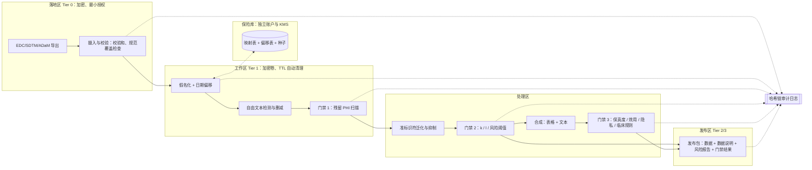

# 临床试验数据隐私保护通用工程方案：去标识化与合成数据（R 实现）

| 项目 | 内容 |
|------|------|
| 文档版本 | 2.0 |
| 适用范围 | I 期、II 期、III 期临床试验数据（含 CDISC SDTM/ADaM 结构化数据与自由文本） |
| 目标读者 | 临床数据管理、生物统计、统计编程、数据科学、信息安全与数据合规团队 |
| 代码语言 | 全部脱敏与合成工程代码为 **R（≥ 4.3）** |
| 定位 | 通用型工程方案：不绑定任何特定下游（统计分析、数据共享、外部合作、机器学习、LLM/Agent 应用、系统测试均适用） |
| 声明 | 本文给出的是工程控制，不构成法律意见；具体合规结论以法务/DPO/伦理委员会意见为准 |

---

## 0. 要点速览

1. **先分级，再处理。** 按用途把数据分为 Tier 0（原始）、Tier 1（假名化）、Tier 2（匿名化）、Tier 3（合成）四级，每级对应明确的允许使用方。下游是统计分析、外部共享还是 LLM，只决定它能拿到哪一级数据，不改变处理流程。
2. **元数据驱动。** 每个变量在 YAML 脱敏规范中声明处理动作（保留、删除、假名化、日期偏移、泛化、文本删减），管道按规范执行。规范未覆盖的新变量直接阻断发布。
3. **去标识化四件套：**
   - 直接标识符：随机令牌替换，映射表加密存入“保险库”。
   - 日期：按受试者一致偏移，保留研究日（--DY）。
   - 准标识符：泛化 + 局部抑制，达到 k-匿名 / l-多样性。
   - 自由文本：规则 + 字典 + 可选 NER 检测后删减。
4. **合成数据以去标识化数据为输入**，必须同时通过保真度、效用（TSTR）、隐私（最近记录距离、精确匹配、复制唯一记录）和临床合理性四类质量门禁。
5. **I 期数据风险最高。** 样本小、常为健康志愿者、单中心，k-匿名常以大量信息损失为代价，合成模型也容易记忆真实记录。默认只做受控访问，不做公开发布。
6. **证据链：** 每次运行记录输入/输出哈希、规范版本、代码版本、质量门禁结果，审计日志用哈希链防篡改。

---

## 1. 范围、数据分级与设计原则

### 1.1 通用定位与数据使用方

本方案处理的是“数据发出之前”的环节，对下游一视同仁：

| 使用方 | 典型需求 | 推荐最高可用级别 |
|------|------|------|
| 申办方内部统计/编程 | 完整分析、纵向关联 | Tier 1（受控环境） |
| CRO / 外部统计合作方 | 按协议分析 | Tier 1（签 DPA/DUA）或 Tier 2 |
| 数据共享平台、学术二次研究 | 再分析、荟萃分析 | Tier 2 |
| 机器学习/预测模型开发 | 训练、特征工程 | Tier 2 或 Tier 3 |
| LLM / Agent 应用（私有部署） | 检索、摘要、问答、编码辅助 | Tier 1（数据不出受控边界）或 Tier 2 |
| LLM / Agent 应用（第三方 API） | 同上 | Tier 2（经风险评估）或 Tier 3 |
| 软件开发、系统测试、培训演示 | 真实感数据、无隐私负担 | Tier 3 |

### 1.2 数据分级

| 级别 | 名称 | 处理 | 法律属性（工程视角） | 存储区 |
|------|------|------|------|------|
| Tier 0 | 原始/可识别 | 无 | 个人信息 / PHI | 落地区（加密、最小授权） |
| Tier 1 | 假名化（去标识化） | 直接标识符令牌化、日期偏移、文本删减 | 仍属个人信息（PIPL 第 73 条“去标识化”、GDPR 假名化数据） | 工作区 |
| Tier 2 | 匿名化 | Tier 1 + 准标识符处理 + 风险评估达标 + 销毁/隔离映射 | 目标是不再属于个人信息（须有风险评估证据） | 发布区 |
| Tier 3 | 合成 | 在 Tier 1/2 上训练生成模型并通过隐私门禁 | 目标是不含真实个体记录（须有隐私评估证据） | 发布区 |

> Tier 1 **不是**匿名数据。只要映射表或偏移量在任何地方存在且可被关联，它在 PIPL 和 GDPR 下都仍是个人信息。

### 1.3 I / II / III 期差异

| 维度 | I 期 | II 期 | III 期 |
|------|------|------|------|
| 典型样本量 | 20–100 | 100–500 | 300–数千 |
| 受试者 | 常为健康志愿者；肿瘤等领域为患者 | 目标患者 | 目标患者、多国多中心 |
| 中心数 | 1–3 | 数个到数十 | 数十到数百 |
| 主要重识别风险 | 小样本 + 单中心 + 精确给药/采样时间 + 可能的志愿者招募公开信息 | 罕见不良事件、罕见合并症 | 跨境传输、外部可关联数据多、自由文本量大 |
| k-匿名可行性 | 低，需大幅泛化 | 中 | 高 |
| 合成数据可行性 | 低（易记忆，建议规则驱动或 DP 汇总） | 中 | 高 |
| 推荐发布形式 | Tier 1 受控访问；对外仅汇总表 | Tier 1/2 | Tier 2/3 |
| 额外关注 | PK 采样时间点（保留相对时间）、剂量组人数极少 | 剂量探索组样本不均 | 国家/地区字段、PIPL 出境、HGR |

罕见病试验无论处于哪一期，都按 I 期的风险等级处理。

### 1.4 设计原则

1. **最小必要：** 先问“这个变量下游真的需要吗”，不需要就删，删除比任何变换都安全。
2. **先去标识化、后合成：** 合成模型只接触 Tier 1/2 数据，永远不接触直接标识符与原始自由文本。
3. **元数据驱动、默认拒绝：** 规范未声明的变量阻断发布。
4. **可复现但不可逆推：** 代码版本、包版本（`renv.lock`）、规范版本入审计；随机种子、偏移量、密钥只存保险库。
5. **职责分离：** 执行去标识化的人不能独自完成再关联；保险库由“诚实中间人”（honest broker）或 DPO 管理。
6. **证据优先：** 每次发布必须能回答“为什么认为这份数据的风险可接受”，并附带可复核的指标。

### 1.5 R 技术栈与代码组织

建议把本文代码组织成内部 R 包或项目仓库：

```text
deid/
├── R/
│   ├── 00_spec.R                # 脱敏规范加载与覆盖检查
│   ├── 10_detect_phi.R          # PHI/PII 检测（规则 + 字典 + 可选 NER）
│   ├── 11_redact_text.R         # 文本删减、文本内日期平移
│   ├── 20_date_shift.R          # ISO 8601 日期偏移
│   ├── 30_pseudonymize.R        # 随机令牌 / 密钥化哈希假名
│   ├── 31_key_vault.R           # 映射表加密存储、再关联
│   ├── 40_quasi_identifiers.R   # 泛化工具
│   ├── 50_risk_assessment.R     # k-匿名、l-多样性、重识别风险
│   ├── 60_synthesize_tabular.R  # synthpop 合成、子表计数、DP 边际
│   ├── 61_synthesize_text.R     # 模板/LLM 文本合成与泄漏检查
│   ├── 70_validate_synthetic.R  # 保真度、TSTR、最近记录距离
│   ├── 80_quality_gates.R       # 临床规则、门禁
│   └── 90_audit.R               # 哈希链审计日志
├── config/deid_spec.yaml
├── _targets.R                   # 管道编排
├── renv.lock
└── tests/testthat/              # 检测器回归测试、金标准集评估
```

所有代码默认依赖：`data.table`、`stringi`、`openssl`、`jsonlite`、`yaml`。各模块的额外依赖在对应章节说明。

> **代码验证状态：** 第 2–5 章中标注“已验证”的代码，以及第 8 章示例，已在 R 4.3.3 上用虚构数据运行通过（data.table 1.14、openssl 2.1、synthpop 1.9-3、sdcMicro 5.8、gower、ranger、pROC）。标注“模板”的代码（spacyr、Presidio REST、ellmer、reticulate/SDV、targets）未在该环境执行，使用前需按团队环境调试。

---

## 2. 变量级脱敏规范（元数据驱动）

### 2.1 SDTM 常见变量分类

| 类别 | 典型变量 | 默认动作 |
|------|------|------|
| 直接标识符 | `SUBJID`、`USUBJID`、`INVNAM`、`INVID`、筛选号、随机号、姓名缩写、病历号 | 删除或假名化 |
| 中心信息 | `SITEID`、中心名称、城市 | 删除或映射到大区；**注意与地区字段的联动泄露**（见 3.4.4） |
| 日期 | `BRTHDTC`、`RFSTDTC`、`RFICDTC`、`DTHDTC`、各域 `--DTC` | 出生日期删除；其余做日期偏移，保留 `--DY` |
| 人口学准标识符 | `AGE`、`SEX`、`RACE`、`ETHNIC`、`COUNTRY`、身高、体重 | 泛化（年龄段、大区、取整） |
| 临床准标识符 | 罕见 `AEDECOD`/`MHDECOD`、罕见合并用药、妊娠、死亡、器官移植 | 罕见值上卷到上级分类（SOC、ATC 上级） |
| 敏感属性 | 治疗分组、HIV/乙肝等检测结果、精神疾病诊断、遗传信息 | 保留但纳入 l-多样性检查；遗传数据另走 HGR 流程 |
| 自由文本 | `AETERM`（逐字）、叙述、`CO` 域评论、`--ORRES` 中的文本 | 检测 + 删减，或直接删除 |
| 数值检验结果 | `LBSTRESN`、`VSSTRESN` | 通常保留；极端值做顶/底编码 |

### 2.2 规范文件（YAML）

```yaml
study_id: ABC-301
phase: 3
release_tier: 2            # 0=原始 1=假名化 2=匿名化 3=合成
risk:
  k: 12
  max_risk: 0.09
  l_sensitive: [ARM]
date_shift:
  strategy: per_subject    # per_subject | per_study | study_day_only
  min_days: -180
  max_days: 180
  keep_weekday: true
domains:
  DM:
    STUDYID: {action: keep}
    USUBJID: {action: pseudonymize, id_type: USUBJID, prefix: "S-"}
    SUBJID:  {action: drop}
    SITEID:  {action: drop}
    INVNAM:  {action: drop}
    BRTHDTC: {action: drop}
    AGE:     {action: generalize, role: quasi, method: age_band, width: 10, top_code: 80}
    SEX:     {action: keep, role: quasi}
    RACE:    {action: generalize, role: quasi, method: collapse_rare, min_n: 12}
    COUNTRY: {action: generalize, role: quasi, method: region_map}
    ARM:     {action: keep, role: sensitive}
    RFSTDTC: {action: date_shift}
    DTHDTC:  {action: date_shift}
  AE:
    USUBJID:  {action: pseudonymize, id_type: USUBJID}
    AETERM:   {action: drop}
    AEDECOD:  {action: generalize, role: quasi, method: rare_to_parent, parent: AEBODSYS, min_subjects: 5}
    AEBODSYS: {action: keep}
    AESTDTC:  {action: date_shift}
    AEENDTC:  {action: date_shift}
    AESTDY:   {action: keep}
    AENARR:   {action: redact_text}
```

### 2.3 规范加载与覆盖检查（已验证）

```r
library(data.table)
library(yaml)

`%||%` <- function(a, b) if (is.null(a)) b else a

load_deid_spec <- function(path) {
  spec <- read_yaml(path)
  valid <- c("keep", "drop", "pseudonymize", "date_shift", "generalize", "redact_text", "suppress")
  rows <- list()
  for (dom in names(spec$domains)) for (var in names(spec$domains[[dom]])) {
    v <- spec$domains[[dom]][[var]]
    if (!v$action %in% valid) stop(sprintf("%s.%s: 未知 action '%s'", dom, var, v$action))
    rows[[length(rows) + 1]] <- data.table(domain = dom, variable = var, action = v$action,
                                           role = v$role %||% NA_character_,
                                           params = list(v[setdiff(names(v), c("action", "role"))]))
  }
  list(meta = spec[setdiff(names(spec), "domains")], vars = rbindlist(rows))
}

check_spec_coverage <- function(spec, domain, data) {
  dom <- domain
  declared <- spec$vars[domain == dom, variable]
  list(undeclared = setdiff(names(data), declared),
       missing = setdiff(declared, names(data)))
}
```

`undeclared` 非空时必须阻断。新增 CRF 字段是最常见的泄露来源，尤其是 EDC 迁移后新增的“备注”类字段。

---

## 3. 数据去标识化

### 3.1 PHI/PII 检测管道

#### 3.1.1 三层检测策略

| 层 | 方法 | 擅长 | 不擅长 |
|------|------|------|------|
| 规则层 | 正则（身份证、手机号、邮箱、病历号、日期、IP、URL、地址、>89 岁年龄、试验内编号格式） | 格式固定的标识符，精确率高 | 人名、机构名、上下文相关信息 |
| 字典层 | 试验已知名单：研究者、协调员、中心/医院名、所在城市、受试者姓名（如 EDC 中存在） | 临床试验特有优势：大部分人名和机构名**事先已知** | 名单外的名字（家属、外院医生） |
| 模型层（可选） | NER：spaCy（经 `spacyr`）、Presidio（REST 服务，R 用 `httr2` 调用）、自训练中文医疗 NER | 名单外人名、地名、机构名 | 需要标注数据评估；中文医疗场景需微调 |

临床试验的特点是研究者、中心、城市名单是已知的，所以“字典层”的性价比远高于通用 NER。建议先把规则层和字典层做扎实，再用 NER 补充召回率。

#### 3.1.2 规则与字典检测（已验证）

依赖：`data.table`、`stringi`。位置以字符计，可直接用于中文文本。

```r
library(data.table)
library(stringi)

phi_rules <- function(study_patterns = character()) {
  rules <- data.table(
    entity = c("CN_ID_CARD", "CN_MOBILE", "PHONE", "EMAIL", "MRN",
               "DATE_CN", "DATE_ISO", "DATE_DMY", "AGE_OVER_89", "IP_ADDRESS",
               "URL", "CN_ADDRESS"),
    pattern = c(
      "(?<![0-9])[1-9]\\d{5}(?:19|20)\\d{2}(?:0[1-9]|1[0-2])(?:0[1-9]|[12]\\d|3[01])\\d{3}[0-9Xx](?![0-9])",
      "(?<![0-9])1[3-9]\\d{9}(?![0-9])",
      "(?<![0-9])(?:0\\d{2,3}-?)?\\d{7,8}(?![0-9])",
      "[A-Za-z0-9._%+-]+@[A-Za-z0-9.-]+\\.[A-Za-z]{2,}",
      "(?:住院号|病案号|门诊号|病历号|MRN|Hospital\\s*No\\.?)[:：\\s]*[A-Za-z0-9-]{4,}",
      "(?<![0-9])(?:19|20)\\d{2}\\s*年\\s*\\d{1,2}\\s*月(?:\\s*\\d{1,2}\\s*日)?",
      "(?<![0-9])(?:19|20)\\d{2}[-/.](?:0?[1-9]|1[0-2])[-/.](?:0?[1-9]|[12]\\d|3[01])(?![0-9])",
      "(?i)(?<![0-9])\\d{1,2}[- ]?(?:JAN|FEB|MAR|APR|MAY|JUN|JUL|AUG|SEP|OCT|NOV|DEC)[A-Z]*[- ]?(?:19|20)\\d{2}",
      "(?<![0-9])(?:9\\d|1[0-2]\\d)\\s*(?:岁|周岁|years?[- ]old|y/o)",
      "(?<![0-9])(?:\\d{1,3}\\.){3}\\d{1,3}(?![0-9])",
      "https?://[^\\s，。]+",
      "[\\p{Han}]{2,}(?:省|市|自治区)[\\p{Han}0-9]{0,20}?(?:区|县|镇|乡)[\\p{Han}0-9]{0,20}?(?:路|街|巷|弄|村)[\\p{Han}0-9]{0,10}?号"
    ),
    priority = c(1L, 1L, 3L, 1L, 1L, 2L, 2L, 2L, 2L, 2L, 2L, 2L)
  )
  if (length(study_patterns)) {
    rules <- rbind(rules, data.table(
      entity = names(study_patterns), pattern = unname(study_patterns), priority = 1L))
  }
  rules
}

detect_regex <- function(text, rules) {
  hits <- lapply(seq_len(nrow(rules)), function(i) {
    loc <- stri_locate_all_regex(text, rules$pattern[i], omit_no_match = TRUE)
    rbindlist(lapply(seq_along(loc), function(d) {
      if (!nrow(loc[[d]])) return(NULL)
      data.table(doc = d, start = loc[[d]][, 1], end = loc[[d]][, 2],
                 entity = rules$entity[i], priority = rules$priority[i],
                 source = "regex")
    }))
  })
  rbindlist(hits)
}

detect_dictionary <- function(text, terms, entity) {
  terms <- unique(terms[!is.na(terms) & nchar(terms) >= 2])
  if (!length(terms)) return(data.table())
  terms <- terms[order(-nchar(terms))]
  pattern <- paste0("(?:", paste(stri_replace_all_regex(terms, "([.\\\\+*?\\[^\\]$(){}=!<>|:-])", "\\\\$1"),
                                 collapse = "|"), ")")
  hits <- detect_regex(text, data.table(entity = entity, pattern = pattern, priority = 1L))
  # 无命中时 hits 是零列表，直接 := 会生成一行全 NA 的伪记录
  if (nrow(hits)) hits[, source := "dictionary"]
  hits
}

merge_spans <- function(spans) {
  if (!nrow(spans)) return(spans)
  setorder(spans, doc, start, priority, -end)
  spans[, grp := cumsum(c(TRUE, start[-1] > cummax(end)[-.N])), by = doc]
  spans[, .(start = min(start), end = max(end),
            entity = entity[1], source = paste(unique(source), collapse = "+")),
        by = .(doc, grp)][, grp := NULL][]
}

detect_phi <- function(text, rules = phi_rules(), dictionaries = list(), ner = NULL) {
  text <- as.character(text)
  text[is.na(text)] <- ""
  parts <- list(detect_regex(text, rules))
  for (nm in names(dictionaries)) parts[[length(parts) + 1]] <- detect_dictionary(text, dictionaries[[nm]], nm)
  if (is.function(ner)) parts[[length(parts) + 1]] <- ner(text)
  spans <- rbindlist(parts, fill = TRUE)
  if (!nrow(spans)) return(data.table(doc = integer(), start = integer(), end = integer(),
                                      entity = character(), source = character()))
  spans[is.na(priority), priority := 2L]
  out <- merge_spans(spans)
  out[, value := stri_sub(text[doc], start, end)]
  out[]
}
```

检测效果示例（实际运行输出）：

```text
    doc      entity                         value
 1:   1  CN_ID_CARD            110105198001011234
 2:   1   CN_MOBILE                   13812345678
 3:   1       EMAIL                     a.b@x.com
 4:   2    DATE_DMY                   12-MAR-2024
 5:   2    DATE_ISO                     2024/3/15
 6:   2 AGE_OVER_89                  92 years old
 7:   2         MRN                 MRN: 00123456
 8:   3  CN_ADDRESS 浙江省杭州市西湖区文三路100号
 9:   3         MRN              病案号：BA-88812
10:   4     DATE_CN                     2023年5月
11:   4  IP_ADDRESS                      10.0.0.1
```

规则维护要点：
- `PHONE`（座机）规则容易误伤实验室数值和批号，因此 `priority` 设为最低；在你的语料上测得精确率后再决定是否启用。
- 试验特有格式（受试者号 `ABC-301-\d{3}-\d{4}`、随机号、样本条码）通过 `study_patterns` 传入。
- 规则库要纳入版本控制并配回归测试（`testthat`）。每次修改都要在金标准集上重新评估（见 3.1.4）。

#### 3.1.3 NER 插件（模板）

`detect_phi()` 的 `ner` 参数接收一个函数：输入文本向量，返回 `doc/start/end/entity/priority/source` 列。下面给出两种 R 接入方式。

**方式 A：spacyr（R 调用本地 spaCy 模型）**

```r
library(spacyr)
spacy_initialize(model = "zh_core_web_trf")   # 或团队微调的中文医疗 NER 模型

ner_spacy <- function(x, types = c("PERSON", "GPE", "LOC", "ORG", "FAC")) {
  ents <- as.data.table(spacy_extract_entity(x, output = "data.frame"))
  if (!nrow(ents)) return(data.table())
  ents <- unique(ents[ent_type %in% types,
                      .(doc = as.integer(sub("text", "", doc_id)), ent = text, entity = ent_type)])
  # spacy_extract_entity 给出的是 token 序号；按实体文本回查字符位置，同一文档中重复出现的全部标出
  ents[, {
    loc <- stri_locate_all_fixed(x[doc], ent)[[1]]
    .(start = loc[, 1], end = loc[, 2])
  }, by = .(doc, ent, entity)][
    !is.na(start), .(doc, start, end, entity, priority = 3L, source = "spacy")]
}
```

**方式 B：Presidio 作为内网 REST 服务，R 用 `httr2` 调用**

Presidio Analyzer 以容器部署在受控网络内，R 端只发 HTTP 请求。这样 R 仍是唯一的工程语言，模型服务可以独立升级。

```r
library(httr2)

ner_presidio <- function(text, endpoint = Sys.getenv("PRESIDIO_URL"), language = "zh",
                         entities = c("PERSON", "LOCATION", "NRP")) {
  res <- lapply(seq_along(text), function(d) {
    if (!nzchar(text[d])) return(NULL)
    r <- request(paste0(endpoint, "/analyze")) |>
      req_body_json(list(text = text[d], language = language, entities = entities)) |>
      req_timeout(10) |>
      req_perform() |>
      resp_body_json()
    if (!length(r)) return(NULL)
    rbindlist(lapply(r, function(e) data.table(
      doc = d, start = e$start + 1L, end = e$end, entity = e$entity_type,
      priority = 3L, source = "presidio", score = e$score)))
  })
  out <- rbindlist(res, fill = TRUE)
  if (nrow(out)) out[score >= 0.6][, score := NULL][] else out
}
```

> Presidio 的偏移量是 0 起始、右开区间，R 的 `stri_sub` 是 1 起始、闭区间，所以 `start + 1L`、`end` 不变。Presidio 默认没有中文模型，需要配置中文 spaCy 模型或自定义 recognizer。

#### 3.1.4 检测器评估（已验证）

上线前必须在**人工标注的金标准集**上评估召回率。建议从各期、各中心、各文本类型（AE 叙述、评论、医学史描述）分层抽样 300–1000 条进行标注。

```r
evaluate_detector <- function(pred, gold) {
  key <- c("doc", "start", "end")
  overlap <- function(a, b) a[b, on = .(doc, start <= end, end >= start), nomatch = 0L,
                              .(doc = x.doc, start = x.start, end = x.end)]
  tp_gold <- uniqueN(overlap(gold, pred), by = key)
  tp_pred <- uniqueN(overlap(pred, gold), by = key)
  list(recall = tp_gold / nrow(gold), precision = tp_pred / nrow(pred),
       missed = fsetdiff(gold[, ..key], unique(overlap(gold, pred))))
}
```

建议门槛：直接标识符类（姓名、证件号、电话、病历号）召回率 ≥ 0.95，且漏检样本逐条复核。宁可多删，不可漏删：精确率低只损失效用，召回率低会泄露隐私。

### 3.2 文本删减与替换（已验证）

| 策略 | 输出示例 | 适用 |
|------|------|------|
| 类型标签 | `由[PERSON]医生处理` | 默认；下游可知被删内容的类型 |
| 掩码 | `由***医生处理` | 需要保留长度时 |
| 替代值（surrogate） | `由张三医生处理` | 训练 NER/LLM 需要自然文本时；替代值须从虚构名单随机抽取，且记录“此处为替代值” |
| 日期平移 | `2025-02-25` | 文本内日期按该受试者的偏移量平移，保持与结构化日期一致 |

```r
redact_text <- function(text, spans, mode = c("tag", "mask"),
                        date_shift = NULL, subject_offset = NULL) {
  mode <- match.arg(mode)
  text <- as.character(text)
  text[is.na(text)] <- ""
  if (!nrow(spans)) return(text)
  sp <- copy(spans)[order(doc, -start)]
  for (i in seq_len(nrow(sp))) {
    d <- sp$doc[i]
    original <- stri_sub(text[d], sp$start[i], sp$end[i])
    replacement <- if (!is.null(date_shift) && grepl("^DATE", sp$entity[i]) &&
                       !is.null(subject_offset)) {
      date_shift(original, subject_offset[d])
    } else if (mode == "tag") {
      paste0("[", sp$entity[i], "]")
    } else {
      strrep("*", nchar(original))
    }
    stri_sub(text[d], sp$start[i], sp$end[i]) <- replacement
  }
  text
}

shift_free_text_date <- function(x, offset) {
  if (is.na(offset)) return("[DATE]")
  norm <- stri_replace_all_regex(x, "\\s", "")
  norm <- stri_replace_all_regex(norm, "[年月/.]", "-")
  norm <- stri_replace_all_fixed(norm, "日", "")
  d <- suppressWarnings(as.Date(norm, format = "%Y-%m-%d"))
  if (is.na(d)) {
    d <- suppressWarnings(as.Date(paste0(norm, "15"), format = "%Y-%m-%d"))
    if (is.na(d)) return("[DATE]")
    return(format(d + offset, "%Y年%m月"))
  }
  format(d + offset, "%Y-%m-%d")
}
```

`shift_free_text_date()` 无法解析的格式（如 `12-MAR-2024`）会退化为 `[DATE]` 标签，属于安全失败。删减完成后要**再跑一遍检测**，残留的高置信命中必须为 0（见 5.2 质量门禁）。

### 3.3 日期偏移

#### 3.3.1 策略选择

| 策略 | 做法 | 保留 | 丢失 | 适用 |
|------|------|------|------|------|
| 按受试者偏移（默认） | 每个受试者一个随机偏移量，其所有日期同步平移 | 受试者内间隔、`--DY`、星期（偏移为 7 的倍数时） | 跨受试者的日历对齐、季节性 | 大多数分析与 ML |
| 按研究偏移 | 全研究同一偏移量 | 跨受试者对齐（入组节奏、批次效应） | 防护较弱：任意一个真实日期泄露即全部还原 | 内部 Tier 1、需分析入组时序时 |
| 仅研究日 | 删除全部 `--DTC`，只保留 `--DY` 及相对时间 | 受试者内时间结构 | 绝对时间 | Tier 2 公开发布、I 期 |
| 仅年份 | 日期截断到年 | 年份 | 月日 | 对齐 HIPAA Safe Harbor 的日期要求 |

工程注意：
- 偏移量必须是**随机抽取并存入保险库**的，不能由受试者 ID 推导（防止知道算法的人重算）。
- 偏移区间常用 ±180 天或 ±365 天。区间越大，季节信息越模糊，但跨年事件（如年龄计算）的影响也越大。
- 出生日期一律删除，年龄改为在源数据中按真实日期计算后再泛化。
- 研究日 `--DY` 在按受试者偏移下保持不变，应保留，不要用偏移后的日期重算。
- 部分日期（`2023-05`、`2023`）按区间中点平移后截回原精度，**不能**补全成完整日期。

#### 3.3.2 实现（已验证）

```r
draw_offsets <- function(subject_ids, min_days = -180L, max_days = 180L,
                         keep_weekday = TRUE, exclude_zero = TRUE) {
  ids <- unique(subject_ids)
  pool <- seq(min_days, max_days)
  if (keep_weekday) pool <- pool[pool %% 7L == 0L]
  if (exclude_zero) pool <- pool[pool != 0L]
  data.table(subject_id = ids,
             offset_days = pool[ceiling(runif(length(ids)) * length(pool))])
}

shift_dtc <- function(dtc, offset_days) {
  dtc <- as.character(dtc)
  out <- dtc
  ok <- !is.na(dtc) & !is.na(offset_days)

  full <- ok & grepl("^\\d{4}-\\d{2}-\\d{2}", dtc)
  ym   <- ok & grepl("^\\d{4}-\\d{2}$", dtc)
  y    <- ok & grepl("^\\d{4}$", dtc)

  if (any(full)) {
    d <- as.Date(substr(dtc[full], 1, 10)) + offset_days[full]
    out[full] <- paste0(format(d, "%Y-%m-%d"), substring(dtc[full], 11))
  }
  # 部分日期：按区间中点平移后截回原精度，避免"补全"出不存在的精度
  if (any(ym)) out[ym] <- format(as.Date(paste0(dtc[ym], "-15")) + offset_days[ym], "%Y-%m")
  if (any(y))  out[y]  <- format(as.Date(paste0(dtc[y], "-07-01")) + offset_days[y], "%Y")

  out[!(full | ym | y) & !is.na(dtc)] <- NA_character_
  out
}

apply_date_shift <- function(dt, offsets, id_col = "USUBJID", dtc_cols) {
  dt <- copy(dt)
  off <- offsets$offset_days[match(dt[[id_col]], offsets$subject_id)]
  for (col in intersect(dtc_cols, names(dt))) set(dt, j = col, value = shift_dtc(dt[[col]], off))
  dt
}
```

- `draw_offsets()` 使用 R 的随机数生成器。生产环境应在运行开始时用 `openssl::rand_num()` 或 `set.seed()` 播种，并**把种子与偏移表一起存入保险库**，不写入日志。
- `shift_dtc()` 保留时间部分（如 `T08:30`），并把无法识别的格式置为 `NA`（安全失败）。

### 3.4 准标识符处理

#### 3.4.1 识别准标识符

判断标准：攻击者能否从外部来源获知该值？

| 外部来源 | 可获知的信息 |
|------|------|
| 公开注册库（ClinicalTrials.gov、药物临床试验登记与信息公示平台） | 中心名单、城市、入组时间段、入排标准 |
| 新闻报道、社交媒体、患者社群 | 严重不良事件、死亡、罕见病个案 |
| 雇主、家人、熟人 | 年龄、性别、居住地、就诊时间、是否参加试验 |
| 其他发布的数据集 | 同一受试者在其他研究中的记录 |

试验中常被低估的准标识符：罕见不良事件（尤其 SAE、死亡）、妊娠、罕见合并用药、极端体重/身高、多胎/双胞胎信息、中心（小中心可能只有 1–2 名受试者）、入组日期、剂量组（I 期剂量递增组常只有 3–6 人）。

#### 3.4.2 泛化工具（已验证）

```r
age_band <- function(age, width = 5L, top_code = 90L, bottom_code = 18L) {
  age <- as.integer(age)
  lo <- pmax((age %/% width) * width, bottom_code)
  band <- ifelse(age < bottom_code, paste0("<", bottom_code),
                 paste0(lo, "-", lo + width - 1L))
  band[age >= top_code] <- paste0(top_code, "+")
  band[is.na(age)] <- NA_character_
  band
}

collapse_rare <- function(x, min_n, parent = NULL, other = "OTHER") {
  x <- as.character(x)
  n <- table(x)
  rare <- x %in% names(n)[n < min_n]
  if (!is.null(parent)) {
    x[rare] <- as.character(parent)[rare]
    n2 <- table(x)
    rare <- x %in% names(n2)[n2 < min_n]
  }
  x[rare] <- other
  x
}

top_bottom_code <- function(x, probs = c(0.01, 0.99)) {
  q <- quantile(x, probs, na.rm = TRUE, names = FALSE)
  pmin(pmax(x, q[1]), q[2])
}

round_to <- function(x, base) base * round(x / base)
```

临床层级泛化：
- **不良事件：** MedDRA 的 PT → HLT → HLGT → SOC。按“受试者数”而不是“事件数”判断稀有度。
- **合并用药：** WHODrug 药品名 → ATC 4 级 → ATC 3 级。
- **病史：** 同 MedDRA；罕见遗传病等直接上卷到 SOC 或删除。
- **地理：** 中心 → 城市 → 省 → 大区 → 国家 → 洲。

#### 3.4.3 k-匿名与 l-多样性（已验证）

- **k-匿名：** 准标识符组合相同的记录（等价类）至少 k 条。
- **l-多样性：** 每个等价类中，敏感属性至少有 l 个不同取值，防止“同一类的人全在试验组 / 全部 HIV 阳性”这类同质性泄露。

```r
reid_risk <- function(dt, qi, k = 5L, threshold = 0.09) {
  x <- copy(dt)[, fk := .N, by = qi]
  r <- 1 / x$fk
  list(
    n_records = nrow(x),
    n_classes = uniqueN(x, by = qi),
    min_class_size = min(x$fk),
    sample_uniques = sum(x$fk == 1L),
    max_risk = max(r),
    avg_risk = mean(r),
    pct_records_above_threshold = mean(r > threshold),
    k_anonymous = min(x$fk) >= k
  )
}

l_diversity <- function(dt, qi, sensitive, l = 2L) {
  per_class <- dt[, .(distinct_l = uniqueN(get(sensitive)), n = .N), by = qi]
  list(min_l = min(per_class$distinct_l),
       violating_classes = per_class[distinct_l < l],
       l_diverse = min(per_class$distinct_l) >= l)
}

enforce_k <- function(dt, qi, k = 5L, suppress_order = rev(qi), marker = "*") {
  x <- copy(dt)
  for (v in qi) set(x, j = v, value = as.character(x[[v]]))
  for (v in suppress_order) {
    x[, fk := .N, by = qi]
    if (min(x$fk) >= k) break
    set(x, i = which(x$fk < k), j = v, value = marker)
  }
  x[, fk := .N, by = qi]
  dropped <- x[fk < k, .N]
  x <- x[fk >= k][, fk := NULL]
  attr(x, "records_dropped") <- dropped
  x[]
}
```

`enforce_k()` 是一个透明、易审计的贪心局部抑制：按 `suppress_order` 依次把仍不满足 k 的记录的某个准标识符改为 `*`，最后仍不满足的记录整条删除，删除数写入属性供审计。`suppress_order` 应把**分析上最不重要**的准标识符放在最前。

#### 3.4.4 联动泄露：被抑制的值能从其他列还原

示例运行中发现了一个典型问题：`REGION` 被局部抑制为 `*`，但同一行保留了假名化的 `SITEID`。同一中心的其他受试者 `REGION` 未被抑制，所以按 `SITEID` 分组即可把 `*` 还原。

规则：**任何与准标识符存在确定性映射的列（中心号 → 地区、国家 → 洲、出生日期 → 年龄、研究日 + 偏移日期 → 真实日期）要么同时处理，要么删除。** 本示例最终在 Tier 2 中删除了 `SITEID` 和精确 `AGE`。

#### 3.4.5 使用 sdcMicro 做正式评估

`sdcMicro` 是统计披露控制领域成熟的 R 包，提供基于抽样权重的个体风险估计、最优局部抑制、l-多样性、PRAM 等方法，适合作为正式风险报告的计算引擎。上面的 `data.table` 实现便于理解和审计，二者可以互相核对。（已验证）

```r
library(sdcMicro)

sdc <- createSdcObj(dat = as.data.frame(dm),
                    keyVars = c("AGEGR", "SEX", "RACE", "REGION"),
                    sensibleVar = "ARM")
kAnon_violations(sdc, weighted = FALSE, k = 12)       # 违反 k-匿名的记录数
sdc@risk$global$risk                                  # 全局风险
# importance：数字越小越重要、越不容易被抑制；此处 RACE 最先保留，SEX 最可能被抑制
sdc <- localSuppression(sdc, k = 12, importance = c(2, 4, 1, 3))
sdc <- ldiversity(sdc, ldiv_index = "ARM", l_recurs_c = 2)
dm_anon <- extractManipData(sdc)
```

> sdcMicro 抑制后的值为 `NA`，这与 SDTM 中原本的缺失值无法区分。发布前建议改写为显式标记（如 `*`），并在数据说明中注明。

### 3.5 可逆与不可逆去标识化

| 维度 | 可逆（假名化） | 不可逆（匿名化） |
|------|------|------|
| 实现 | 随机令牌 + 加密映射表；或密钥化哈希（HMAC），密钥单独保管 | 不生成映射表，或销毁映射表/密钥（加密粉碎）；再叠加准标识符处理 |
| 能否再关联 | 能，经审批由保险库管理员执行 | 不能 |
| 法律属性 | 仍是个人信息 | 达标后不再是个人信息 |
| 典型用途 | 药物警戒追溯、长期随访合并、数据纠错回写、受试者撤回同意后删除 | 公开发布、外部共享、第三方 LLM |
| 发布范围 | Tier 1 | Tier 2/3 |

#### 3.5.1 两种假名生成方式（已验证）

```r
library(openssl)

new_vault <- function() {
  list(ids = data.table(id_type = character(), original = character(),
                        pseudonym = character(), created_at = character()),
       offsets = data.table(subject_id = character(), offset_days = integer()))
}

random_token <- function(n, prefix, nbytes = 6L) {
  hex <- toupper(as.character(rand_bytes(n * nbytes)))
  paste0(prefix, vapply(split(hex, rep(seq_len(n), each = nbytes)), paste, character(1), collapse = ""))
}

pseudonymize <- function(x, id_type, vault, prefix = paste0(id_type, "-")) {
  x <- as.character(x)
  it <- id_type
  new_vals <- setdiff(unique(x[!is.na(x)]), vault$ids[id_type == it, original])
  if (length(new_vals)) {
    repeat {
      tok <- random_token(length(new_vals), prefix)
      if (!anyDuplicated(tok) && !any(tok %in% vault$ids$pseudonym)) break
    }
    vault$ids <- rbind(vault$ids, data.table(
      id_type = it, original = new_vals, pseudonym = tok,
      created_at = format(Sys.time(), "%Y-%m-%dT%H:%M:%SZ", tz = "UTC")))
  }
  lookup <- vault$ids[id_type == it]
  list(values = lookup$pseudonym[match(x, lookup$original)], vault = vault)
}

keyed_pseudonym <- function(x, key, prefix = "", nchar_out = 16L) {
  h <- vapply(as.character(x), function(v) {
    if (is.na(v)) return(NA_character_)
    as.character(sha256(charToRaw(enc2utf8(v)), key = key))
  }, character(1), USE.NAMES = FALSE)
  ifelse(is.na(h), NA_character_, paste0(prefix, substr(h, 1, nchar_out)))
}
```

| 方式 | 优点 | 缺点 | 建议 |
|------|------|------|------|
| `pseudonymize()` 随机令牌 + 映射表 | 令牌与原值无数学关系；符合 HIPAA 对再识别代码“不得由个人信息派生”的保守解读 | 需要维护有状态的映射表 | **默认方案** |
| `keyed_pseudonym()` HMAC-SHA256 | 无状态，多系统可独立算出相同假名，便于跨数据源关联 | 密钥泄露则全部可被字典攻击还原；属于“由个人信息派生” | 仅用于 GDPR/PIPL 框架下的内部跨系统关联，密钥由 KMS 托管 |

其他做法：
- **按接收方重新令牌化：** 给不同接收方的发布使用不同的令牌，防止多个接收方合并数据集。
- **增量交付：** 每次交付先查保险库中已有映射，新受试者才分配新令牌，`pseudonymize()` 已实现这一逻辑。

### 3.6 映射表安全存储与再关联

#### 3.6.1 保险库加密（已验证）

映射表与偏移表一起序列化后，用 AES-256-GCM 加密（带完整性校验，篡改即解密失败）。数据密钥由 KMS 或密钥管理服务在运行时注入环境变量，不写入代码、配置文件或日志。

```r
get_data_key <- function(env_var = "DEID_DATA_KEY") {
  hex <- Sys.getenv(env_var)
  if (!nzchar(hex)) stop("缺少数据密钥环境变量 ", env_var, "，应由 KMS/密钥管理服务在运行时注入")
  key <- hex2raw(hex)
  if (length(key) != 32L) stop("数据密钥必须是 256 位（64 个十六进制字符）")
  key
}

hex2raw <- function(hex) as.raw(strtoi(substring(hex, seq(1, nchar(hex), 2), seq(2, nchar(hex), 2)), 16L))

save_vault <- function(vault, path, key = get_data_key(), key_id = Sys.getenv("DEID_KEY_ID", "local-dev")) {
  iv <- rand_bytes(12)
  ct <- aes_gcm_encrypt(serialize(vault, NULL), key = key, iv = iv)
  envelope <- list(format = "deid-vault/v1", key_id = key_id, iv = iv, ciphertext = ct,
                   sha256_plain = as.character(sha256(serialize(vault, NULL))),
                   written_at = format(Sys.time(), "%Y-%m-%dT%H:%M:%SZ", tz = "UTC"))
  tmp <- paste0(path, ".tmp")
  saveRDS(envelope, tmp)
  Sys.chmod(tmp, mode = "0600")
  file.rename(tmp, path)
  invisible(envelope$sha256_plain)
}

load_vault <- function(path, key = get_data_key()) {
  env <- readRDS(path)
  stopifnot(identical(env$format, "deid-vault/v1"))
  unserialize(aes_gcm_decrypt(env$ciphertext, key = key, iv = env$iv))
}
```

> `readRDS()`/`unserialize()` 只能用于本系统写出的可信文件。保险库目录必须只有管道服务账号可写。

#### 3.6.2 存储与密钥管理要求

| 控制项 | 要求 |
|------|------|
| 物理隔离 | 保险库与 Tier 1/2 数据放在**不同的存储账户/桶/服务器**，访问凭据分开 |
| 密钥 | 信封加密：数据密钥由 KMS 主密钥加密保存；R 进程运行时取得明文数据密钥，不落盘。可用 `paws`（AWS KMS）、`AzureKeyVault` 或内部 KMS API |
| 本地开发 | 只用虚构数据，可用 `keyring` 包存开发密钥；**禁止**用生产密钥 |
| 访问 | 最小授权；保险库读权限仅授予诚实中间人/DPO 角色 |
| 密钥轮换 | 定期（如每年）或人员变动时：`load_vault()` 用旧密钥解密后 `save_vault()` 用新密钥重写，`key_id` 随之更新；旧密钥按保留策略销毁 |
| 备份 | 加密备份，异地存放，恢复演练纳入年度计划 |
| 销毁 | 试验归档期满或转为 Tier 2 匿名发布后，按审批销毁保险库与密钥（加密粉碎），并在审计日志中记录 |

#### 3.6.3 再关联流程（已验证）

再关联的典型场景：药物警戒需要定位到具体受试者、监管核查、受试者撤回同意需删除数据、数据纠错。

```r
relink <- function(pseudonyms, id_type, vault, request_id, requester, approver, audit) {
  if (missing(request_id) || !nzchar(request_id)) stop("重新关联必须提供已审批的申请编号")
  if (identical(requester, approver)) stop("申请人与审批人不能为同一人")
  it <- id_type
  lookup <- vault$ids[id_type == it]
  out <- lookup$original[match(pseudonyms, lookup$pseudonym)]
  audit("RELINK", list(request_id = request_id, requester = requester, approver = approver,
                       id_type = id_type, n = length(pseudonyms), n_found = sum(!is.na(out))))
  out
}
```

流程：申请（写明目的与范围）→ DPO/数据治理委员会审批 → 诚实中间人在隔离环境执行 `relink()` → 结果通过加密通道只交付给申请人 → 审计日志记录申请号、双方身份和数量（不记录原始 ID）。

### 3.7 重识别风险评估

#### 3.7.1 指标

| 指标 | 定义 | 含义 |
|------|------|------|
| 最小等价类 `min_class_size` | min(fk) | 即 k-匿名中的 k |
| 最大风险 `max_risk`（检察官风险） | max(1/fk) | 攻击者确知目标在数据集中、针对某个人时的最坏情况 |
| 平均风险 `avg_risk` | mean(1/fk) = 等价类数 / 记录数 | 攻击者随机尝试重识别时的期望成功率（营销者风险） |
| 样本唯一数 `sample_uniques` | fk = 1 的记录数 | 首要处理对象 |
| 超阈值记录比例 | mean(1/fk > 阈值) | 风险分布的尾部 |
| 记者风险 | 需要人群层面的等价类规模（如人口普查、疾病登记），可用 sdcMicro 加抽样权重估计 | 攻击者不确定目标是否参加试验时的风险，通常低于检察官风险 |

> 阈值与 k 的换算：最大风险 ≤ 0.09 要求 min(fk) ≥ 12（1/11 ≈ 0.0909 > 0.09）。示例因此使用 k = 12。

#### 3.7.2 阈值参考（由团队与法务/伦理共同确定）

| 场景 | 常见参考 |
|------|------|
| 公开发布（临床研究报告公开、开放数据） | 最大风险 0.09（EMA Policy 0070 与 Health Canada 临床信息公开指南中常引用的阈值） |
| 受控访问（签数据使用协议、在可信研究环境中分析） | 可结合合同与环境控制放宽，如 0.2，并提供环境控制证据 |
| I 期 / 罕见病 | 通常无法在可接受的信息损失下达到公开阈值，默认只做受控访问 |

#### 3.7.3 评估流程

1. **威胁建模：** 列出攻击者类型（公众、熟人、外部研究者、内部员工）和他们可获得的外部数据。
2. **确定准标识符集合：** 依据 3.4.1，必要时分多套集合评估（例如“熟人”场景加入入组月份）。
3. **计算指标**（`reid_risk()` / sdcMicro）。如果有多张表，先构建**受试者级准标识符表**，把罕见 AE、妊娠、死亡等受试者级标记一并纳入。
4. **处理与再评估**，直到达标，并记录信息损失（被抑制单元数、删除记录数、上卷类别数）。
5. **动机攻击者测试（motivated intruder test）：** 请不参与处理的同事在规定时间内，用公开信息尝试重识别若干高风险记录，并记录结果。
6. **出具风险评估报告：** 内容包括数据范围、威胁模型、准标识符、处理方法、指标、阈值、结论、信息损失、残余风险、有效期（外部数据环境变化后需重评）。

---

## 4. 合成数据

### 4.1 方法选型

| 方法 | R 实现 | 适用 | 注意 |
|------|------|------|------|
| 序贯 CART / 参数模型 | `synthpop`（`syn()`） | 中小规模表格数据，临床试验受试者级表的首选 | 需逐变量选方法；罕见结局建议用参数模型 |
| 对抗随机森林 | `arf`（`adversarial_rf()` → `forde()` → `forge()`） | 混合类型表格数据，无需 GPU | 较新，需与 synthpop 对比验证 |
| 规则/模拟驱动 | `simstudy`、基础 R | 依据方案和文献参数生成，不接触真实数据；I 期与系统测试 | 只保留设定的结构，没有真实数据中的意外模式 |
| 差分隐私边际合成 | 基础 R（4.6 节） | 需要形式化隐私保证；对外发布汇总级合成数据 | 高维联合分布难以保留；小样本时噪声占主导 |
| CTGAN / TVAE | `reticulate` 调用 Python SDV | 大样本（数千条以上）、复杂非线性 | 需要 Python 运行时；小样本易模式崩溃或记忆 |
| 文本合成 | `glue` 模板；`ellmer` 调用 LLM（优先本地模型） | AE 叙述、医学评论 | 只能以**合成后的结构化字段**为输入 |

一般顺序：先用 `synthpop` 建立基线，不达标再尝试 `arf` 或 CTGAN。I 期优先采用规则驱动方式。

### 4.2 表格合成（synthpop，已验证）

```r
library(synthpop)

synthesize_subjects <- function(dt, visit_sequence = names(dt), seed,
                                method = "cart", minbucket = 10L, m = 1L,
                                smoothing = list()) {
  df <- as.data.frame(dt)[, visit_sequence, drop = FALSE]
  chr <- vapply(df, is.character, logical(1))
  df[chr] <- lapply(df[chr], factor)
  # synthpop 在其他环境中求值 ... 参数，必须传入字面值
  args <- list(data = df, method = method, m = m, seed = seed,
               cart.minbucket = minbucket, print.flag = FALSE)
  if (length(smoothing)) args$smoothing <- smoothing
  syn_obj <- do.call(syn, args)
  syn_obj <- sdc(syn_obj, df, rm.replicated.uniques = TRUE)
  syn_obj
}
```

参数要点：
- `visit_sequence`：合成顺序。先放治疗分组、人口学等“上游”变量，再放基线检查，最后放结局（AE 数、SAE）。
- `method`：可按变量分别指定，例如 `c("sample", rep("cart", 7), "logreg")`。第一个变量通常用 `"sample"`。**罕见二分类结局（如 SAE）建议用 `"logreg"`**。第 8 章示例中（10 次重复划分的均值），这一改动把 TSTR 比值从 0.67 提升到 0.97。
- `cart.minbucket`：叶子节点最小样本量。值越大越不容易记忆个体，但细节损失越多；小样本试验建议 ≥ 10。
- `smoothing`：CART 会从叶子中抽取**真实观测值**，连续变量可对其做平滑（`"spline"`/`"density"`）以减少原值复现。
- `sdc(..., rm.replicated.uniques = TRUE)`：删除与真实数据中唯一记录完全相同的合成记录，作为必做的后处理。
- synthpop 1.8 起提供 `disclosure()` / `multi.disclosure()`，可计算身份与属性披露指标，建议纳入隐私评估报告。

### 4.3 多表与纵向结构

临床试验数据是“受试者 → 访视 → 记录”的层级结构，不宜把各域分别独立合成（会破坏跨表一致性）。推荐分层合成：

1. **受试者级表：** DM + 基线特征 + 受试者级汇总（AE 数、是否 SAE、完成状态），用 `synthesize_subjects()`。
2. **子表记录数：** 以合成受试者的特征为条件，生成每人的 AE 条数、合并用药条数。
3. **子表属性：** 以受试者特征为条件，合成每条记录的属性（PT、严重程度、相关性、研究日）。
4. **纵向实验室数据：** 转成宽表（每个检验项目 × 访视一列）后合成，再转回长表；或用混合效应模型拟合轨迹后模拟。
5. **一致性后处理：** 重算 `--SEQ`、`--DY`，检查访视窗口、结束日 ≥ 开始日、合理范围（见 4.7.4）。

子表计数的示例（已验证）：

```r
synthesize_child_counts <- function(parent_syn, parent_real, child_real, id_col, by_cols, seed) {
  set.seed(seed)
  counts <- child_real[, .N, by = id_col]
  real <- merge(parent_real[, c(id_col, by_cols), with = FALSE], counts, by = id_col, all.x = TRUE)
  real[is.na(N), N := 0L]
  fit <- glm(reformulate(by_cols, "N"), family = poisson(), data = real)
  mu <- predict(fit, newdata = parent_syn, type = "response")
  rpois(nrow(parent_syn), mu)
}
```

AE 计数常有过离散，生产中可换成负二项（`MASS::glm.nb`）或零膨胀模型。

### 4.4 CTGAN / TVAE（可选，模板）

R 生态中没有成熟的原生 CTGAN 实现。确有需要时，可在 R 中通过 `reticulate` 调用 SDV，工程代码与编排仍保留在 R 中：

```r
library(reticulate)
use_virtualenv("sdv-env", required = TRUE)   # 预先在受控镜像中安装 sdv
sdv_meta <- import("sdv.metadata")
sdv_single <- import("sdv.single_table")

fit_ctgan <- function(df, epochs = 300L, seed = 42L) {
  py_set_seed(seed)
  meta <- sdv_meta$SingleTableMetadata()
  meta$detect_from_dataframe(r_to_py(df))
  synth <- sdv_single$CTGANSynthesizer(meta, epochs = as.integer(epochs))
  synth$fit(r_to_py(df))
  synth
}

sample_ctgan <- function(synth, n) as.data.frame(py_to_r(synth$sample(num_rows = as.integer(n))))
```

使用条件：样本量至少数千、synthpop 基线不达标、有 GPU 或可接受的训练时间，且必须通过与 synthpop 相同的验证（4.7）。SDV 的部分高级功能有商业许可限制，引入前需确认许可条款。

### 4.5 文本合成

**原则：** 合成文本只能由**合成后的结构化字段**驱动。不能把真实叙述作为提示词或微调语料发送给外部模型。

#### 4.5.1 模板生成（已验证，默认方案）

```r
library(glue)

ae_narrative_template <- function(ae) {
  sev <- c(MILD = "轻度", MODERATE = "中度", SEVERE = "重度")
  rel <- c(RELATED = "相关", "POSSIBLY RELATED" = "可能相关", "NOT RELATED" = "无关")
  acn <- c("DOSE NOT CHANGED" = "研究药物剂量未调整", "DOSE REDUCED" = "研究药物减量",
           "DRUG INTERRUPTED" = "研究药物暂停给药", "DRUG WITHDRAWN" = "研究药物永久停用")
  out <- c(RECOVERED = "已恢复", RECOVERING = "恢复中", "NOT RECOVERED" = "未恢复")
  glue_data(ae,
    "受试者于研究第{AESTDY}天出现{sev[AESEV]}{AEDECOD}（{AEBODSYS}）",
    "{ifelse(AESER == 'Y', '，判定为严重不良事件', '')}。",
    "研究者评估与研究药物{rel[AEREL]}，{acn[AEACN]}。转归：{out[AEOUT]}。")
}
```

模板方式完全可控、可复现、不会引入虚构标识符。缺点是语言多样性不足。

#### 4.5.2 LLM 生成（模板）

需要更自然的语言多样性时（例如训练文本分类或抽取模型），可用 `ellmer` 调用模型。**优先使用私有部署或本地模型**（如通过 Ollama 部署的开源模型），使数据不离开受控边界：

```r
library(ellmer)

llm_narratives <- function(ae_syn, chat_factory, batch_size = 20L) {
  prompt_for <- function(row) glue(
    "根据以下【合成】不良事件结构化字段，写一段 60-120 字的中文不良事件叙述。",
    "只能使用给出的字段，不得虚构人名、日期、医院、地名、编号。\n",
    "研究日: {row$AESTDY}; 首选术语: {row$AEDECOD}; 系统器官分类: {row$AEBODSYS}; ",
    "严重程度: {row$AESEV}; 是否严重: {row$AESER}; 相关性: {row$AEREL}; ",
    "采取措施: {row$AEACN}; 转归: {row$AEOUT}")
  out <- character(nrow(ae_syn))
  for (start in seq(1L, nrow(ae_syn), by = batch_size)) {
    idx <- start:min(start + batch_size - 1L, nrow(ae_syn))
    chat <- chat_factory()
    out[idx] <- vapply(idx, function(i) as.character(chat$chat(prompt_for(ae_syn[i]), echo = "none")),
                       character(1))
  }
  out
}

# 本地模型示例：chat_factory <- function() chat_ollama(model = "qwen2.5:7b-instruct")
```

`chat_factory` 按批次新建会话，防止上下文累积，也避免前面的样本影响后面的生成。

#### 4.5.3 文本后检查（已验证）

LLM 输出必须经过两道检查：一是用 `detect_phi()` 扫描虚构出的标识符（模型可能编造人名、医院名），二是与真实叙述做 n-gram 重叠检测，防止复述训练语料。

```r
char_ngrams <- function(x, n = 8L) {
  x <- stri_replace_all_regex(x, "\\s+", "")
  if (nchar(x) < n) return(x)
  unique(stri_sub(x, 1:(nchar(x) - n + 1L), length = n))
}

text_leakage <- function(synthetic, real, n = 8L, max_overlap = 0.2) {
  real_grams <- unique(unlist(lapply(real, char_ngrams, n = n)))
  overlap <- vapply(synthetic, function(s) {
    g <- char_ngrams(s, n)
    mean(g %in% real_grams)
  }, numeric(1), USE.NAMES = FALSE)
  data.table(idx = seq_along(synthetic), ngram_overlap = overlap,
             exact_copy = synthetic %in% real, flagged = overlap > max_overlap | synthetic %in% real)
}
```

> 解释注意：如果真实叙述本身就由相同模板生成（很多 EDC 系统就是这样），模板合成文本与真实文本的重叠必然很高（示例中 12-gram 中位重叠率为 0.93）。此时重叠来自模板本身，只要内容由合成字段驱动，就不构成个体泄露。**n-gram 检查主要针对 LLM 生成的自由文本。**

### 4.6 差分隐私（可选）

#### 4.6.1 基本概念

- **ε（隐私预算）：** 任意一人的数据加入或移除，输出分布的变化不超过 e^ε 倍。常见取值 0.1–10，越小越安全，噪声越大。
- **δ：** 允许以极小概率突破保证，通常取小于 1/n。
- **敏感度：** 单条记录对查询结果的最大影响。计数查询为 1；均值查询需先把数据裁剪到 [L, U]，敏感度为 (U − L)/n。
- **组合性：** 多次查询的 ε 相加，所以要事先分配总预算并记账。
- **后处理不变性：** 对 DP 输出做任何处理（包括基于其抽样生成合成数据）都不会削弱保证。
- **单位：** 隐私单位必须是“受试者”，而不是“记录”。一个受试者有多条 AE 时，需先限制每人的贡献数（例如每人最多 k 条），敏感度相应变为 k。

#### 4.6.2 DP 边际合成（已验证）

```r
dp_laplace_counts <- function(counts, epsilon, sensitivity = 1) {
  noisy <- counts + rexp(length(counts), epsilon / sensitivity) * sample(c(-1, 1), length(counts), TRUE)
  pmax(round(noisy), 0)
}

dp_synthesize_marginal <- function(x, n_out, epsilon, domain = sort(unique(x))) {
  counts <- as.numeric(table(factor(x, levels = domain)))
  noisy <- dp_laplace_counts(counts, epsilon)
  if (sum(noisy) == 0) noisy[] <- 1
  sample(domain, n_out, replace = TRUE, prob = noisy / sum(noisy))
}
```

两点工程注意：
1. `domain` 必须来自**公开或先验知识**（如 CDISC 受控术语、MedDRA SOC 列表），不能从真实数据中提取，否则“哪些类别存在”这一信息本身就泄露了隐私。上面函数的默认值仅用于演示。
2. 拉普拉斯噪声由两个指数分布之差构造；`rexp`/`sample` 使用的伪随机数生成器不是密码学安全的。用于正式发布时，建议采用经过审计的 DP 库（例如 OpenDP，或经 `reticulate` 调用的 SmartNoise），并由熟悉 DP 的人员复核预算分配。

适用判断：
- 一维或二维边际 + 简单模型的合成，在样本量为数千的 III 期数据上可以取得可用的结果。
- I 期等小样本场景下，噪声会淹没信号。建议只发布 DP 汇总表，不发布 DP 合成的个体级数据。
- 深度生成模型的 DP 训练（DP-SGD）需要 Python 生态，且对样本量要求很高，不作为默认选项。

### 4.7 合成数据验证

四类验证缺一不可。

#### 4.7.1 保真度（已验证）

```r
library(gower)
library(ranger)
library(pROC)

harmonize <- function(...) {
  dfs <- list(...)
  cols <- names(dfs[[1]])
  all <- rbindlist(lapply(dfs, function(d) as.data.table(lapply(as.data.frame(d)[cols], function(v)
    if (is.numeric(v)) as.numeric(v) else as.character(v)))), idcol = "src")
  chr <- setdiff(names(Filter(is.character, all)), "src")
  all[, (chr) := lapply(.SD, factor), .SDcols = chr]
  lapply(seq_along(dfs), function(i) as.data.frame(all[src == i][, src := NULL]))
}

fidelity_univariate <- function(real, syn) {
  h <- harmonize(real, syn)
  rbindlist(lapply(names(h[[1]]), function(v) {
    r <- h[[1]][[v]]; s <- h[[2]][[v]]
    if (is.factor(r)) {
      pr <- prop.table(table(r)); ps <- prop.table(table(s))
      data.table(variable = v, metric = "total_variation_distance",
                 value = 0.5 * sum(abs(pr - ps)), lost_categories = sum(pr > 0 & ps == 0))
    } else {
      data.table(variable = v, metric = "ks_statistic",
                 value = suppressWarnings(ks.test(r, s)$statistic[[1]]), lost_categories = NA_integer_)
    }
  }))
}

fidelity_correlation <- function(real, syn) {
  h <- harmonize(real, syn)
  num <- names(Filter(is.numeric, h[[1]]))
  if (length(num) < 2) return(NA_real_)
  d <- abs(cor(h[[1]][num], use = "pairwise.complete.obs") - cor(h[[2]][num], use = "pairwise.complete.obs"))
  max(d[upper.tri(d)], na.rm = TRUE)
}
```

此外还要用 `synthpop::utility.gen(syn_obj, real)` 计算 pMSE / S_pMSE（倾向得分区分度，衡量整体多变量分布差异；S_pMSE 越接近 1 越好）。用 `synthpop::compare()` 可以出分布对比图。

**临床专项保真度**（按试验类型选择）：
- 按治疗组 × SOC 的 AE 发生率表
- 实验室检查的基线 → 最差值 shift 表
- 主要终点的组间效应量及其置信区间
- 生存终点的 Kaplan–Meier 曲线
- 访视完成率与脱落模式

#### 4.7.2 效用：TSTR（已验证）

TSTR（Train on Synthetic, Test on Real）：用合成数据训练模型，在**未参与合成的真实保留集**上测试，再与 TRTR（在真实训练集上训练、同一保留集上测试）比较。

```r
tstr <- function(real_train, real_test, syn, target, positive, seed = 1L) {
  h <- harmonize(real_train, real_test, syn)
  h <- lapply(h, function(d) { d$y <- factor(d[[target]] == positive, levels = c(FALSE, TRUE)); d[[target]] <- NULL; d })
  fit_auc <- function(train) {
    m <- ranger(y ~ ., data = train, probability = TRUE, seed = seed, num.trees = 300)
    as.numeric(auc(h[[2]]$y, predict(m, h[[2]])$predictions[, "TRUE"], quiet = TRUE))
  }
  trtr <- fit_auc(h[[1]]); ts <- fit_auc(h[[3]])
  list(auc_trtr = trtr, auc_tstr = ts, ratio = ts / trtr)
}
```

要点：
- 保留集必须在训练生成模型**之前**划出，且生成模型从未见过它。
- 目标变量选择下游真正关心的问题（如 SAE 预测、应答预测）。
- 小样本时 AUC 波动大，建议重复多个随机划分或用 bootstrap 给出区间，不要只看单次结果。
- 推断型用途还要比较回归系数：分别在真实和合成数据上拟合同一模型，比较系数与置信区间的重叠度（可用 `synthpop::glm.synds()` + `compare()`）。

#### 4.7.3 隐私（已验证）

```r
dcr_privacy <- function(train, holdout, syn, seed = 1L) {
  set.seed(seed)
  tr <- as.data.frame(train)[sample(nrow(train), min(nrow(train), nrow(holdout))), , drop = FALSE]
  h <- harmonize(tr, holdout, syn)
  d_tr <- gower_topn(h[[3]], h[[1]], n = 1)$distance[1, ]
  d_ho <- gower_topn(h[[3]], h[[2]], n = 1)$distance[1, ]
  list(
    closer_to_train_share = mean(ifelse(d_tr == d_ho, 0.5, d_tr < d_ho)),
    exact_match_train = mean(d_tr == 0),
    exact_match_holdout = mean(d_ho == 0)
  )
}
```

解释：
- 训练集抽样到与保留集同样大小后，对每条合成记录分别求它到训练集和保留集的最近距离（Gower 距离，支持混合类型变量）。
- 如果生成模型没有记忆训练数据，合成记录离两者一样近，`closer_to_train_share` 约为 0.5。明显大于 0.5 说明合成数据“偏向”训练个体，即存在记忆。
- `exact_match_train` 不应明显高于 `exact_match_holdout`。在低维类别数据中，偶然完全相同是正常的，所以要和保留集基线比，而不是要求为 0。
- 补充：synthpop 的复制唯一记录数（`sdc()` 已删除）、`disclosure()` 指标；高风险发布可加做成员推断攻击模拟。

> 不要用“合成→训练集最近距离的第 5 百分位 ÷ 保留集同一指标”作为隐私指标。示例中在以类别变量为主的数据上，这个比值在不同划分间从约 0.45 波动到 1.0，无法用于判断。

#### 4.7.4 临床合理性（已验证）

```r
check_rules <- function(dt, rules) {
  rbindlist(lapply(names(rules), function(nm) {
    ok <- dt[, eval(parse(text = rules[[nm]]))]
    data.table(rule = nm, expr = rules[[nm]], n_fail = sum(!ok, na.rm = TRUE), n_na = sum(is.na(ok)))
  }))
}

# 规则由医学/数据管理团队维护，表达式来自受控配置文件，不接受外部输入
clinical_rules <- c(
  pregnancy_male  = "!(SEX == 'M' & AEDECOD == '妊娠')",
  end_after_start = "is.na(AEENDY) | AEENDY >= AESTDY",
  hgb_range       = "HGB >= 30 & HGB <= 250"
)
```

常见规则：性别特异事件（妊娠、前列腺相关）、年龄与入排标准一致、结束日 ≥ 开始日、剂量在方案规定的剂量水平内、死亡后无新事件、实验室数值在生理可能范围内、访视在窗口内。

### 4.8 常见陷阱

| 陷阱 | 表现 | 检测 | 缓解 |
|------|------|------|------|
| 模式崩溃 / 罕见类别丢失 | 罕见 PT、少数族裔、剂量组消失 | `fidelity_univariate()` 的 `lost_categories`；按类别比较频数 | 罕见类别先上卷；条件采样；换方法 |
| 罕见结局关系丢失 | SAE 与年龄/分组的关系变弱，TSTR 偏低 | TSTR 比值 | 结局变量用参数模型（示例：`logreg` 把比值均值从 0.67 提升到 0.97）；调整 `visit_sequence` |
| 记录泄露 | 合成记录与真实个体完全或几乎相同 | `dcr_privacy()`、复制唯一记录、`disclosure()` | 增大 `minbucket`；连续变量平滑；`sdc()` 删除复制唯一记录；DP |
| 原值复现 | CART 直接抽取真实连续值（如精确体重 73.4） | 合成值在真实值集合中的比例 | `smoothing`、取整 |
| 小样本过拟合 | I 期 30 人的数据，合成结果几乎就是原数据重排 | 上述全部指标；人工比对 | 不做个体级合成；改用规则驱动或 DP 汇总 |
| 跨表不一致 | AE 记录属于不存在的受试者；男性妊娠 | 参照完整性 + `check_rules()` | 分层合成 + 一致性后处理 |
| 时间结构破坏 | 事件早于入组、访视顺序颠倒 | 规则检查 | 合成研究日而非日期；后处理排序 |
| 在未去标识化数据上训练 | 生成模型记住姓名或自由文本 | 输入数据审查 | 只用 Tier 1/2 数据训练；不把自由文本送入表格生成器 |
| 误用合成数据做推断 | 用合成数据得出疗效结论 | 流程管控 | 发布说明中写明用途限制：合成数据不用于监管递交与疗效推断 |
| 认为合成数据必然安全 | 跳过隐私评估直接公开 | 门禁 | 合成数据与匿名化数据同等对待，必须通过隐私门禁 |

---

## 5. 端到端管道架构

### 5.1 架构总览



### 5.2 阶段与质量门禁

下表阈值为建议默认值，由团队按试验和用途确定后写入规范文件。

| 阶段 | 门禁 | 默认阈值 | 失败处理 |
|------|------|------|------|
| 摄入 | 输入文件校验和与传输清单一致 | 完全一致 | 阻断 |
| 摄入 | 规范覆盖：未声明变量 | 0 | 阻断，补充规范 |
| 去标识化 | 删减后残留高置信 PHI（证件号、电话、邮箱、病历号、字典命中） | 0 | 阻断，修规则 |
| 去标识化 | 检测器在金标准集上的召回率（直接标识符类） | ≥ 0.95 | 阻断上线 |
| 去标识化 | 自由文本人工抽检 | 每批 ≥ 200 条或 10%，0 漏检 | 阻断 |
| 匿名化 | 最大风险 | ≤ 0.09（公开）/ 按协议（受控） | 继续泛化/抑制 |
| 匿名化 | 指定敏感变量 l-多样性 | l ≥ 2 | 继续处理 |
| 匿名化 | 信息损失（抑制单元比例、删除记录比例） | 记录并评审，如删除 ≤ 5% | 评审后决定 |
| 合成 | 单变量 TVD / KS 最大值 | ≤ 0.1 | 调参/换方法 |
| 合成 | S_pMSE | ≤ 3（经验值，需在本团队数据上校准） | 调参/换方法 |
| 合成 | TSTR / TRTR（多次重复划分的均值） | ≥ 0.9 | 调参/换方法 |
| 合成 | 偏向训练集比例（`closer_to_train_share`，多次重复划分的均值） | ≤ 0.6 | 增大 `minbucket`/平滑/DP |
| 合成 | 复制唯一记录 | 0（`sdc()` 后） | 阻断 |
| 合成 | 临床规则违背 | 0 | 后处理或重合成 |
| 合成文本 | 与真实文本完全相同、PHI 残留 | 0 | 丢弃该条 |
| 发布 | 发布包完整性（数据说明、风险报告、门禁记录、哈希） | 齐全 | 阻断 |

门禁实现（已验证）：

```r
gate <- function(name, value, op = c("<=", ">=", "=="), threshold, audit = NULL) {
  op <- match.arg(op)
  pass <- switch(op, "<=" = value <= threshold, ">=" = value >= threshold, "==" = value == threshold)
  res <- data.table(gate = name, value = value, op = op, threshold = threshold, pass = isTRUE(pass))
  if (is.function(audit)) audit("QUALITY_GATE", as.list(res))
  res
}

run_gates <- function(gates, stop_on_fail = TRUE) {
  res <- rbindlist(gates)
  if (stop_on_fail && !all(res$pass)) {
    print(res[pass == FALSE])
    stop("质量门禁未通过，禁止发布")
  }
  res
}
```

### 5.3 管道编排（targets，模板）

`targets` 提供依赖跟踪、增量重跑和可复现的执行记录，适合编排上述阶段：

```r
# _targets.R
library(targets)
tar_option_set(
  packages = c("data.table", "stringi", "openssl", "jsonlite", "yaml", "synthpop", "gower", "ranger", "pROC"),
  format = "qs",                     # 中间产物格式；目录须位于加密卷
  error = "stop"
)
tar_source("R")

list(
  tar_target(spec_file, "config/deid_spec.yaml", format = "file"),
  tar_target(spec, load_deid_spec(spec_file)),
  tar_target(raw_dm, fread(Sys.getenv("LANDING_DM")), cue = tar_cue(mode = "always")),
  tar_target(raw_ae, fread(Sys.getenv("LANDING_AE")), cue = tar_cue(mode = "always")),
  tar_target(coverage_ok, {
    cov <- check_spec_coverage(spec, "DM", raw_dm)
    if (length(cov$undeclared)) stop("未声明变量: ", paste(cov$undeclared, collapse = ", "))
    TRUE
  }),
  tar_target(tier1, run_tier1(raw_dm, raw_ae, spec)),          # 假名化 + 日期偏移 + 文本删减，保险库写入在函数内部完成
  tar_target(gate1, run_gates(list(gate("residual_phi", tier1$residual_hits, "==", 0)))),
  tar_target(tier2, run_tier2(tier1, spec)),                    # 泛化 + enforce_k
  tar_target(gate2, run_gates(list(
    gate("max_risk", tier2$risk$max_risk, "<=", spec$meta$risk$max_risk),
    gate("l_div", tier2$ldiv$min_l, ">=", 2)))),
  tar_target(synthetic, run_synthesis(tier2, seed = Sys.getenv("SYNTH_SEED"))),
  tar_target(gate3, run_gates(synthetic$gates)),
  tar_target(release, write_release(tier2, synthetic, list(gate1, gate2, gate3)), format = "file")
)
```

`run_tier1()`、`run_tier2()`、`run_synthesis()`、`write_release()` 是对前文函数的组合，第 8 章示例展示了完整的调用顺序。注意：
- 保险库（映射表、偏移量）**不得**作为 target 的返回值，否则会以明文形式进入 `_targets/` 缓存。应在函数内部直接调用 `save_vault()` 写入保险库，只返回不含映射的数据。
- `_targets/` 目录放在加密卷上，并加入 `.gitignore`。

### 5.4 审计日志（已验证）

每条记录包含上一条记录的哈希，形成哈希链：任何中间记录被修改或删除，`verify_audit_chain()` 都会返回 `FALSE`。

```r
library(jsonlite)

audit_logger <- function(path, run_id, actor = Sys.getenv("USER", "system")) {
  prev <- if (file.exists(path) && length(lines <- readLines(path, warn = FALSE))) {
    fromJSON(lines[length(lines)])$hash
  } else "GENESIS"
  function(event, details = list()) {
    rec <- list(ts = format(Sys.time(), "%Y-%m-%dT%H:%M:%OS3Z", tz = "UTC"),
                run_id = run_id, actor = actor, event = event, details = details,
                prev_hash = prev)
    rec$hash <- as.character(openssl::sha256(toJSON(rec, auto_unbox = TRUE, digits = NA)))
    cat(toJSON(rec, auto_unbox = TRUE, digits = NA), "\n", file = path, append = TRUE, sep = "")
    prev <<- rec$hash
    invisible(rec$hash)
  }
}

verify_audit_chain <- function(path) {
  prev <- "GENESIS"
  for (line in readLines(path, warn = FALSE)) {
    rec <- fromJSON(line, simplifyVector = FALSE)
    h <- rec$hash
    rec$hash <- NULL
    if (!identical(rec$prev_hash, prev)) return(FALSE)
    if (!identical(as.character(openssl::sha256(toJSON(rec, auto_unbox = TRUE, digits = NA))), h)) return(FALSE)
    prev <- h
  }
  TRUE
}

file_sha256 <- function(path) {
  con <- file(path, "rb"); on.exit(close(con))
  as.character(openssl::sha256(con))
}
```

审计内容规范：

| 记录 | 不记录 |
|------|------|
| 运行 ID、时间（UTC）、执行账号 | 原始标识符、姓名、原始日期 |
| 输入/输出文件 SHA-256 | 偏移量、随机种子、密钥 |
| 规范文件版本与哈希、git 提交号、`renv.lock` 哈希 | 被删减的文本原文 |
| 各阶段计数（检测命中数按类型、抑制数、删除数） | 任何可还原个体的中间值 |
| 门禁名称、数值、阈值、是否通过 | |
| 再关联申请号、申请人、审批人、数量 | |

生产环境中，应把日志同步写入只追加（WORM）存储或集中日志平台，哈希链与其互为补充。审计追踪的设计可参照 21 CFR Part 11 和 ICH E6(R3) 对数据完整性的要求。

### 5.5 中间产物安全存储

| 产物 | 风险 | 控制 |
|------|------|------|
| Tier 0 导出文件 | 最高 | 落地区加密；处理完成后按保留策略转冷存储或删除 |
| 保险库 | 最高 | 见 3.6.2 |
| `_targets/` 缓存、`.RData`、`.Rhistory` | 容易被忽视的明文副本 | 放在加密卷；禁用自动保存工作区（`R --no-save`，RStudio 设置 “Never save workspace”）；`.gitignore` |
| `tempdir()` | 临时明文文件 | 设置 `TMPDIR` 指向加密卷；运行结束后清理 |
| 日志与控制台输出 | 调试时打印出数据 | 代码评审禁止 `print()` 原始数据；日志只记录计数 |
| 版本控制仓库 | 示例数据、测试数据含真实信息 | 仓库只允许虚构数据；提交前钩子扫描 |
| 开发者本地 | 数据被下载到笔记本电脑 | 只在受控的分析环境（如 Posit Workbench、可信研究环境）中处理；禁止下载 |

### 5.6 下游接入控制（含 LLM / Agent）

所有下游统一通过“发布区 + 接入策略”获取数据：

1. **按级别授权：** 接入策略表声明每个下游可获取的最高级别（见 1.1）。
2. **出口扫描：** 任何数据离开受控边界前（包括发给外部 API 的请求体），先用 `detect_phi()` 扫描，命中即阻断。
3. **LLM / Agent 特别要求：**
   - 第三方 API 只允许 Tier 2/3 数据。合同中需确认：不用于训练、数据驻留位置、日志保留期限、是否涉及跨境传输（涉及则按 6.3 处理）。
   - Tier 1 数据只能用于私有部署模型。向量库、检索索引、提示词缓存、Agent 记忆同样视为 Tier 1 存储，适用相同的加密、访问控制和保留策略。
   - Agent 的工具调用权限中不得包含保险库或 Tier 0 存储。
   - 模型输出同样执行出口扫描（模型可能从上下文中复述标识符）。
4. **其他下游**（CRO、数据共享平台、学术合作）：数据使用协议中禁止尝试重识别、禁止与其他数据关联、禁止再转让，并约定数据销毁条款。

---

## 6. 合规工程控制

以下内容将法规要求转化为工程控制与证据，**不构成法律意见**。适用哪些法规、采用哪种路径，需由法务/DPO 结合试验所在地、受试者所在地和数据流向判断。

### 6.1 HIPAA（美国）

| 要求 | 工程控制 | 实现 | 证据 |
|------|------|------|------|
| Safe Harbor（45 CFR §164.514(b)(2)）：删除 18 类标识符，且对剩余信息无“实际知晓”可识别 | 变量规范把 18 类全部标记为 drop/pseudonymize；文本检测覆盖姓名、地址、日期、电话、传真、邮箱、各类编号、URL、IP 等 | `deid_spec.yaml`、`phi_rules()`、字典 | 规范文件、检测评估报告、残留扫描结果 |
| Safe Harbor 日期：与个人相关的日期只能保留年份 | 日期截断到年；或改走 Expert Determination 以保留偏移日期 | `shift_dtc()` 外加截断，或“仅研究日”策略 | 规范中的日期策略 |
| Safe Harbor 年龄：> 89 岁合并为 90+ | `age_band(top_code = 90)`；文本中 `AGE_OVER_89` 规则 | 3.4.2、3.1.2 | 分布表 |
| Safe Harbor 地理：小于州的地理单位删除，邮编前 3 位需满足人口条件 | 地区泛化映射 | `region_map` | 映射表 |
| Expert Determination（§164.514(b)(1)）：专家确定重识别风险“非常小” | 量化风险评估 + 文档化方法 | 3.7 全流程 | 风险评估报告（专家签署） |
| Limited Data Set（§164.514(e)）：可保留日期、城市、州、邮编，需签数据使用协议 | 作为 Tier 1 的一种受控形式 | 规范中的 `release_tier: 1` | DUA |
| 再识别代码（§164.514(c)）：不得由个人信息派生、不得披露生成机制 | 随机令牌 + 保险库 | `pseudonymize()`、3.6 | 保险库访问记录 |

注：申办方是否属于 HIPAA 覆盖实体需个案判断；即使不直接适用，Safe Harbor 的 18 类标识符也是检测规则的良好清单。

### 6.2 GDPR（欧盟）

| 要求 | 工程控制 | 实现 |
|------|------|------|
| 假名化定义（第 4(5) 条）：额外信息须单独保存，并有技术和组织措施防止关联 | 保险库物理隔离、KMS 密钥、职责分离 | 3.6 |
| 假名化数据仍是个人数据（序言第 26 条）；匿名数据不受 GDPR 管辖 | Tier 1 按个人数据管理；Tier 2/3 需有匿名化评估证据 | 1.2、3.7、4.7.3 |
| 健康数据属特殊类别（第 9 条），科研处理需有适当保障（第 89(1) 条，含假名化与数据最小化） | 最小必要、默认假名化 | 1.4、2 |
| 隐私设计与默认（第 25 条）、处理安全（第 32 条） | 元数据驱动的默认拒绝、加密、访问控制、审计 | 2、3.6、5.4、5.5 |
| 数据保护影响评估（第 35 条） | 每个试验或发布类型执行 DPIA，引用本方案的控制 | 风险评估报告可作附件 |
| 跨境传输（第五章） | 传输前确认传输机制（充分性认定、标准合同条款等） | 5.6 接入策略 |
| 数据主体权利（如撤回同意后删除） | 经保险库再关联定位记录 | `relink()` |

EDPB 于 2025 年发布了关于假名化的指南（Guidelines 01/2025），对“假名化域”、额外信息隔离等有详细说明，可作为工程设计参考。

### 6.3 中国：PIPL 及相关规定

| 要求 | 工程控制 | 实现 |
|------|------|------|
| 去标识化与匿名化的区分（PIPL 第 73 条）；匿名化信息不属于个人信息（第 4 条） | Tier 1 = 去标识化（仍是个人信息）；Tier 2 = 匿名化（需证明“无法识别且不能复原”） | 1.2；匿名化需销毁或隔离映射并有风险评估 |
| 医疗健康信息属敏感个人信息（第 28 条），需取得单独同意（第 29 条） | 在知情同意书模板与同意管理中区分数据二次使用、跨境、提供给第三方等事项；管道读取同意状态并过滤 | 摄入阶段过滤未同意数据（在规范中增加 `consent_filter`） |
| 安全措施（第 51 条）：加密、去标识化、权限、培训、应急预案 | 加密存储、保险库、访问控制、审计 | 3.6、5.4、5.5 |
| 个人信息保护影响评估（第 55、56 条）：处理敏感个人信息、向境外提供、委托处理时须事前评估，记录至少保存 3 年 | 每个发布类型做 PIPIA；审计日志与风险报告保留 ≥ 3 年 | 5.4（审计保留策略） |
| 出境（第 38–40 条）：安全评估、标准合同或认证，以及单独同意（第 39 条） | 发布包标记“是否含个人信息”与“目的地”；含个人信息出境时，管道要求附带出境合规审批编号 | 5.6 接入策略 + 门禁 |
| 数据出境具体门槛（《数据出境安全评估办法》、2024 年《促进和规范数据跨境流动规定》等） | 统计每年累计出境的敏感个人信息涉及人数，供法务判断适用路径 | 审计日志按受试者去重计数 |
| 人类遗传资源（《人类遗传资源管理条例》及实施细则） | 规范中标记遗传/基因组变量（如药物基因组学数据），这类变量默认不进入对外发布包，并单独走 HGR 审批 | 规范中新增 `role: hgr` |
| 去标识化标准 | 参照 GB/T 37964-2019《信息安全技术 个人信息去标识化指南》、GB/T 42460-2023《信息安全技术 个人信息去标识化效果评估指南》 | 风险评估报告结构可对照 GB/T 42460 |
| 伦理审查 | 二次使用和数据共享方案提交伦理委员会（《涉及人的生命科学和医学研究伦理审查办法》） | 发布包附伦理批件编号 |

> 工程上最重要的一点：**在中国法律框架下，按受试者偏移日期、令牌化 ID 的 Tier 1 数据仍是敏感个人信息。** 出境与提供给第三方的规则对它全部适用。只有达到匿名化（Tier 2 且映射不可获得），或使用通过隐私门禁的合成数据（Tier 3），才可能改变这一定性，而且需要书面评估支撑。

### 6.4 临床数据公开相关

- **EMA Policy 0070** 与 **Health Canada 临床信息公开（PRCI）**：要求在公开临床研究报告前进行匿名化，并提交匿名化报告。量化方法中常用 0.09 作为风险阈值。本方案的风险评估报告结构可直接复用。
- **欧盟临床试验法规（EU CTR 536/2014）** 的透明度要求：上传 CTIS 的文件需要处理个人数据。
- **PhUSE 针对 CDISC SDTM/ADaM 的去标识化标准**：提供变量级的处理建议，可用于初始化本方案的 `deid_spec.yaml`。

---

## 7. 工具与库推荐

| 用途 | 工具 | 何时使用 | 备注 |
|------|------|------|------|
| 数据操作 | `data.table` | 默认 | 大数据量下性能好，引用语义便于控制副本 |
| 文本与正则 | `stringi` | 默认 | ICU 引擎，Unicode/中文支持完善，位置以字符计 |
| 中文分词 | `jiebaR` | 需要基于词的字典匹配或自建 NER 特征时 | |
| NER | `spacyr` | 有可用的中文/医疗 spaCy 模型时 | 需要 Python 运行时 |
| NER 服务 | Presidio（REST）+ `httr2` | 团队已有 Presidio 或需要统一的检测服务时 | 服务独立部署，R 只做客户端 |
| 统计披露控制 | `sdcMicro` | 正式的风险评估与局部抑制；需要抽样权重或 PRAM 时 | 带 GUI（`sdcApp()`），便于非程序员复核 |
| 汇总表保护 | `sdcTable` | 发布汇总表（如按中心 × 年龄段的计数表）时做单元格抑制 | |
| 加密 | `openssl` | AES-GCM、SHA-256、HMAC、安全随机数 | 默认 |
| 加密（替代） | `sodium` | 需要 libsodium 原语（如 XChaCha20-Poly1305）时 | |
| 密钥 | `keyring`（开发）；`paws` / `AzureKeyVault` / 内部 KMS API（生产） | 按环境选择 | 生产禁止使用环境文件存放密钥 |
| 规范 | `yaml` | 默认 | |
| 表格合成 | `synthpop` | 默认首选 | 自带效用与披露评估 |
| 表格合成（替代） | `arf` | synthpop 效果不佳的混合类型数据 | |
| 模拟 | `simstudy` | I 期、系统测试、无法使用真实数据时 | |
| 深度合成 | `reticulate` + SDV | 大样本且其他方法不达标时 | 需 Python；注意 SDV 许可条款 |
| 差分隐私 | 基础 R（演示）；OpenDP / SmartNoise（经审计的实现） | 需要形式化保证时 | |
| LLM 调用 | `ellmer` | 文本合成；对接私有部署或本地模型 | 结合 5.6 节的出口扫描 |
| 模板 | `glue` | 模板化文本合成 | |
| 验证 | `gower`、`ranger`、`pROC` | 最近记录距离、TSTR | |
| 数据校验 | `pointblank` 或 `validate` | 规则较多、需要校验报告时 | 4.7.4 提供基础 R 的轻量实现 |
| 编排 | `targets` | 默认 | |
| 可复现 | `renv` | 默认 | `renv.lock` 哈希写入审计 |
| 测试 | `testthat` | 检测规则回归测试、金标准评估 | |
| 存储格式 | `arrow`（Parquet） | 大数据量的中间产物与发布 | 配合加密卷 |

---

## 8. 实战示例：DM / LB / AE / CM 四域

### 8.1 示例数据结构

示例数据全部由代码随机生成（600 名受试者，12 个中心，两组），字段遵循 SDTM 命名。

| 域 | 主要字段 | 隐私相关处理 |
|------|------|------|
| DM 人口学 | `STUDYID` `USUBJID` `SUBJID` `SITEID` `AGE` `SEX` `RACE` `ARM` `BRTHDTC` `RFSTDTC` `WEIGHT` | 删除 `SUBJID`/`BRTHDTC`；`USUBJID` 令牌化；`SITEID` → 大区后删除；`AGE` → 10 岁段（80+）后删除精确值；`WEIGHT` 顶底编码并取整到 5 kg；`RFSTDTC` 偏移 |
| LB 实验室 | `USUBJID` `VISITNUM` `LBTESTCD` `LBSTRESN` `LBDTC` `LBDY` | `LBDTC` 偏移；`LBDY` 保留 |
| AE 不良事件 | `USUBJID` `AEDECOD` `AEBODSYS` `AESEV` `AESER` `AEREL` `AEACN` `AEOUT` `AESTDTC` `AESTDY` `AENARR`（叙述） | 罕见 PT（受试者 < 5）上卷到 SOC；`AESTDTC` 偏移；叙述检测删减，文本内日期同步偏移 |
| CM 合并用药 | `USUBJID` `CMDECOD` `CMSTDTC` | `CMSTDTC` 偏移；罕见药品可上卷到 ATC（示例未展开） |

AE 叙述中约 30% 混入了就诊日期、医院名、住院号、研究者姓名和手机号，用于检验检测管道。

### 8.2 完整示例脚本（已验证）

把第 2–5 章的函数分别保存为 `R/` 目录下的文件后，运行以下脚本：

```r
suppressPackageStartupMessages({
  library(data.table); library(stringi); library(openssl)
})
for (f in sort(list.files("R", full.names = TRUE))) source(f, encoding = "UTF-8")

# ---- 0. 构造演示数据（全部为虚构） ----
set.seed(20261122)
n <- 600
sites <- data.table(SITEID = sprintf("%03d", 1:12),
                    city = c("上海","北京","广州","成都","武汉","西安","杭州","南京","长沙","沈阳","昆明","乌鲁木齐"),
                    COUNTRY = "CHN")
dm <- data.table(
  STUDYID = "ABC-301",
  SUBJID  = sprintf("%04d", 1:n),
  SITEID  = sample(sites$SITEID, n, TRUE, prob = c(20,18,12,10,8,8,6,6,4,4,2,2)),
  AGE     = pmin(pmax(round(rnorm(n, 56, 12)), 18), 93),
  SEX     = sample(c("M","F"), n, TRUE),
  RACE    = sample(c("ASIAN","WHITE","OTHER"), n, TRUE, prob = c(.92,.05,.03)),
  ARM     = sample(c("DRUG 10MG","PLACEBO"), n, TRUE),
  BRTHDTC = NA_character_,
  RFSTDTC = format(as.Date("2024-03-01") + sample(0:300, n, TRUE))
)
dm[, USUBJID := paste(STUDYID, SITEID, SUBJID, sep = "-")]
dm[, BRTHDTC := format(as.Date(RFSTDTC) - AGE * 365.25 - sample(0:364, n, TRUE), "%Y-%m-%d")]
dm[, WEIGHT := round(rnorm(n, ifelse(SEX == "M", 70, 58), 10), 1)]

pt <- data.table(
  AEDECOD  = c("恶心","头痛","腹泻","乏力","皮疹","ALT升高","中性粒细胞减少","间质性肺病","史蒂文斯-约翰逊综合征"),
  AEBODSYS = c("胃肠系统疾病","各类神经系统疾病","胃肠系统疾病","全身性疾病及给药部位各种反应",
               "皮肤及皮下组织类疾病","各类检查","血液及淋巴系统疾病","呼吸系统、胸及纵隔疾病","皮肤及皮下组织类疾病"),
  w = c(30, 25, 20, 20, 10, 10, 8, 1, 0.3))
n_ae <- rpois(n, ifelse(dm$ARM == "PLACEBO", 1.0, 1.8))
ae <- dm[rep(seq_len(n), n_ae), .(USUBJID, RFSTDTC, SITEID, AGE, ARM)]
pick <- sample(nrow(pt), nrow(ae), TRUE, prob = pt$w)
ae[, `:=`(AEDECOD = pt$AEDECOD[pick], AEBODSYS = pt$AEBODSYS[pick])]
ae[, AESTDY := sample(1:120, .N, TRUE)]
ae[, AESTDTC := format(as.Date(RFSTDTC) + AESTDY - 1)]
ae[, AESEV := sample(c("MILD","MODERATE","SEVERE"), .N, TRUE, prob = c(.6,.3,.1))]
ae[, AESER := ifelse(runif(.N) < plogis(-4 + 0.04 * (AGE - 50) + 1.2 * (ARM != "PLACEBO") + 1.5 * (AESEV == "SEVERE")), "Y", "N")]
ae[, AEREL := sample(c("RELATED","POSSIBLY RELATED","NOT RELATED"), .N, TRUE)]
ae[, AEACN := sample(c("DOSE NOT CHANGED","DOSE REDUCED","DRUG INTERRUPTED","DRUG WITHDRAWN"), .N, TRUE, prob = c(.7,.1,.15,.05))]
ae[, AEOUT := sample(c("RECOVERED","RECOVERING","NOT RECOVERED"), .N, TRUE, prob = c(.8,.15,.05))]
ae[, AESEQ := seq_len(.N), by = USUBJID]
investigators <- c("王建国", "李晓梅", "张伟")
ae[, AENARR := paste0(ae_narrative_template(ae),
                      ifelse(runif(.N) < .3,
                             paste0("受试者于", format(as.Date(AESTDTC), "%Y年%m月%d日"),
                                    "至", sites$city[match(SITEID, sites$SITEID)], "市第一人民医院就诊（住院号：ZY", sample(100000:999999, .N), "），",
                                    "由", sample(investigators, .N, TRUE), "医生处理，联系电话1", sample(3:9, .N, TRUE),
                                    sprintf("%09d", sample(1e8:999999999, .N)), "。"), ""))]
ae[, c("RFSTDTC", "SITEID", "AGE", "ARM") := NULL]

lb <- dm[rep(seq_len(n), each = 4), .(USUBJID, RFSTDTC, SEX)]
lb[, VISITNUM := rep(1:4, n)]
lb[, LBDY := c(1, 29, 57, 85)[VISITNUM]]
lb[, LBDTC := format(as.Date(RFSTDTC) + LBDY - 1)]
lb <- lb[rep(seq_len(.N), each = 2)][, LBTESTCD := rep(c("ALT","HGB"), .N / 2)]
lb[, LBSTRESN := ifelse(LBTESTCD == "ALT", round(rlnorm(.N, log(25), .4)),
                        round(rnorm(.N, ifelse(SEX == "M", 145, 128), 12)))]
lb[, c("RFSTDTC","SEX") := NULL]

cm <- dm[sample(.N, 400, TRUE), .(USUBJID, RFSTDTC)]
cm[, CMDECOD := sample(c("阿司匹林","二甲双胍","氨氯地平","阿托伐他汀","奥美拉唑","依达拉奉"), .N, TRUE,
                       prob = c(20,15,15,15,10,1))]
cm[, CMSTDTC := format(as.Date(RFSTDTC) - sample(0:1000, .N, TRUE))]
cm[, RFSTDTC := NULL]

dir.create("out", showWarnings = FALSE)
audit <- audit_logger("out/audit.jsonl", run_id = "ABC-301-REL01")
audit("INGEST", list(domains = c("DM","AE","LB","CM"), n_subjects = nrow(dm)))

# ---- 1. 直接标识符：随机假名 + 加密映射表 ----
# 演示用：生产环境由 KMS 注入 DEID_DATA_KEY
Sys.setenv(DEID_DATA_KEY = paste(as.character(rand_bytes(32)), collapse = ""))
vault <- new_vault()
r <- pseudonymize(dm$USUBJID, "USUBJID", vault, prefix = "S-"); vault <- r$vault
subj_map <- data.table(USUBJID = dm$USUBJID, NEWID = r$values)
region_map <- c(上海="华东", 杭州="华东", 南京="华东", 北京="华北", 沈阳="东北", 广州="华南", 长沙="华中",
                武汉="华中", 成都="西南", 昆明="西南", 西安="西北", 乌鲁木齐="西北")
dm[, REGION := unname(region_map[sites$city[match(SITEID, sites$SITEID)]])]
r <- pseudonymize(dm$SITEID, "SITEID", vault, prefix = "SITE-"); vault <- r$vault; dm[, SITEID := r$values]

# ---- 2. 日期偏移（按受试者，一致偏移，保留星期） ----
vault$offsets <- draw_offsets(dm$USUBJID)
dm <- apply_date_shift(dm, vault$offsets, dtc_cols = c("RFSTDTC"))
ae <- apply_date_shift(ae, vault$offsets, dtc_cols = c("AESTDTC"))
lb <- apply_date_shift(lb, vault$offsets, dtc_cols = c("LBDTC"))
cm <- apply_date_shift(cm, vault$offsets, dtc_cols = c("CMSTDTC"))
save_vault(vault, "out/vault_ABC-301.rds.enc")
audit("PSEUDONYMIZE_AND_SHIFT", list(n_ids = nrow(vault$ids), vault_file = "vault_ABC-301.rds.enc"))

# ---- 3. 自由文本：检测 + 删减（文本中的日期按同一偏移平移） ----
rules <- phi_rules(study_patterns = c(SUBJECT_ID = "ABC-301-\\d{3}-\\d{4}"))
spans <- detect_phi(ae$AENARR, rules,
                    dictionaries = list(PERSON = investigators,
                                        FACILITY = paste0(sites$city, "市第一人民医院")))
offset_by_doc <- vault$offsets$offset_days[match(ae$USUBJID, vault$offsets$subject_id)]
ae[, AENARR := redact_text(AENARR, spans, date_shift = shift_free_text_date, subject_offset = offset_by_doc)]
residual <- detect_phi(ae$AENARR, rules, dictionaries = list(PERSON = investigators))
audit("REDACT_TEXT", list(spans_found = nrow(spans), by_entity = as.list(spans[, .N, by = entity][, setNames(N, entity)]),
                          residual_hits = nrow(residual[!grepl("^DATE", entity)])))

# ---- 4. 替换受试者 ID，删除直接标识符 ----
swap_id <- function(d) d[, USUBJID := subj_map$NEWID[match(USUBJID, subj_map$USUBJID)]]
swap_id(dm); swap_id(ae); swap_id(lb); swap_id(cm)
dm[, c("SUBJID", "BRTHDTC", "STUDYID") := NULL]

# ---- 5. 准标识符泛化 + 风险评估 ----
qi <- c("AGEGR", "SEX", "RACE", "REGION")
dm[, AGEGR := age_band(AGE, width = 10, top_code = 80)]
dm[, WEIGHT := round_to(top_bottom_code(WEIGHT), 5)]
dm[, c("AGE", "SITEID") := NULL]          # 见 3.4.4：SITEID 会还原被抑制的 REGION

ae_rare <- ae[, .(n_subj = uniqueN(USUBJID)), by = AEDECOD][n_subj < 5, AEDECOD]
ae[, AEDECOD := ifelse(AEDECOD %in% ae_rare, AEBODSYS, AEDECOD)]

print(reid_risk(dm, qi, k = 12, threshold = 0.09))
dm_k <- enforce_k(dm, qi, k = 12)
risk <- reid_risk(dm_k, qi, k = 12, threshold = 0.09)
print(risk); print(l_diversity(dm_k, qi, "ARM", l = 2)[c("min_l", "l_diverse")])
audit("RISK_ASSESSMENT", c(risk[c("n_records","max_risk","avg_risk","k_anonymous")], list(k = 12, threshold = 0.09)))

# ---- 6. 合成：受试者级表 ----
subj <- merge(dm_k[, .(USUBJID, AGEGR, SEX, RACE, REGION, ARM, WEIGHT)],
              ae[, .(N_AE = .N, ANY_SAE = any(AESER == "Y")), by = USUBJID], by = "USUBJID", all.x = TRUE,
              sort = FALSE)   # 假名是随机令牌，按其排序会使后续划分不可复现
subj[is.na(N_AE), `:=`(N_AE = 0L, ANY_SAE = FALSE)]
subj <- merge(subj, lb[LBTESTCD == "ALT" & VISITNUM == 1, .(USUBJID, ALT_BL = LBSTRESN)], by = "USUBJID", sort = FALSE)
subj[, `:=`(USUBJID = NULL, ANY_SAE = factor(ANY_SAE))]

vs <- c("ARM","SEX","AGEGR","RACE","REGION","WEIGHT","ALT_BL","N_AE","ANY_SAE")
methods <- list(cart = "cart", "cart+logreg" = c("sample", rep("cart", 7), "logreg"))
# 单次划分的指标波动很大，重复 10 次随机划分后看均值与范围
evals <- rbindlist(lapply(1:10, function(rep_seed) {
  set.seed(rep_seed)
  idx <- sample(nrow(subj), floor(.7 * nrow(subj)))
  train <- subj[idx]; holdout <- subj[-idx]          # holdout 不参与合成
  rbindlist(lapply(names(methods), function(variant) {
    syn_obj <- synthesize_subjects(train, visit_sequence = vs, seed = rep_seed, minbucket = 10,
                                   method = methods[[variant]])
    syn_dt <- as.data.table(syn_obj$syn)
    fu <- fidelity_univariate(train, syn_dt)
    ts <- tstr(train, holdout, syn_dt, target = "ANY_SAE", positive = "TRUE")
    pv <- dcr_privacy(train, holdout, syn_dt, seed = rep_seed)
    data.table(variant, rep_seed,
               max_tvd = max(fu[metric == "total_variation_distance", value]),
               max_ks = max(fu[metric == "ks_statistic", value]),
               s_pmse = utility.gen(syn_obj, as.data.frame(train)[vs], print.flag = FALSE)$S_pMSE,
               auc_trtr = ts$auc_trtr, auc_tstr = ts$auc_tstr, tstr_ratio = ts$ratio,
               closer_to_train = pv$closer_to_train_share,
               exact_train = pv$exact_match_train, exact_holdout = pv$exact_match_holdout)
  }))
}))
summ <- evals[, lapply(.SD, function(v) sprintf("%.2f [%.2f, %.2f]", mean(v), min(v), max(v))),
              by = variant, .SDcols = !c("rep_seed")]
print(t(summ))

# ---- 7. 合成文本：基于合成结构化字段的模板叙述 + 泄漏检查 ----
ae_cols <- c("AEDECOD","AESEV","AESER","AEREL","AEACN","AEOUT","AESTDY")
syn_ae <- as.data.table(synthesize_subjects(ae[, ..ae_cols], seed = 7, minbucket = 20)$syn)
syn_ae[, AEBODSYS := pt$AEBODSYS[match(AEDECOD, pt$AEDECOD)]]
syn_ae[is.na(AEBODSYS), AEBODSYS := AEDECOD]
syn_ae[, (names(syn_ae)) := lapply(.SD, function(v) if (is.factor(v)) as.character(v) else v)]
syn_txt <- ae_narrative_template(syn_ae)
leak <- text_leakage(syn_txt, ae$AENARR, n = 12, max_overlap = 0.5)
cat("synthetic narratives:", nrow(leak), " exact copies:", sum(leak$exact_copy),
    " median 12-gram overlap:", round(median(leak$ngram_overlap), 2), "\n")

# ---- 8. 发布与核查 ----
audit("RELEASE", list(files = c("dm.csv")))
fwrite(dm_k, "out/dm.csv")
cat("audit chain valid:", verify_audit_chain("out/audit.jsonl"), "\n")
v2 <- load_vault("out/vault_ABC-301.rds.enc")
cat("vault roundtrip:", fsetequal(v2$ids, vault$ids), "\n")
relink(head(subj_map$NEWID, 2), "USUBJID", vault, request_id = "RL-2026-001",
       requester = "safety_physician", approver = "dpo", audit = audit)
```

### 8.3 运行结果（R 4.3.3 实际输出）

**文本删减**（处理前后对照，原文为虚构）：

```text
处理前：……转归：已恢复。受试者于2024年11月12日至西安市第一人民医院就诊（住院号：ZY726905），由张伟医生处理，联系电话182********。
处理后：……转归：已恢复。受试者于2025-02-25至[FACILITY]就诊（[MRN]），由[PERSON]医生处理，联系电话[CN_MOBILE]。
```

（随机生成的手机号可能恰好是真实号码，所以“处理前”一行在本文档中用星号遮盖。）该受试者的偏移量为 +105 天（7 的倍数，星期不变）。文本内日期随之平移，与结构化字段 `AESTDTC` 保持一致。共检测到 246 条叙述中的 5 类实体（日期、医院、住院号、人名、手机号各 246 处）；删减后再次扫描，残留的非日期 PHI 命中数为 0。

**准标识符与风险**（准标识符为年龄段、性别、种族、大区）：

| 指标 | 泛化后、抑制前 | `enforce_k(k = 12)` 后 |
|------|------|------|
| 记录数 | 600 | 600（删除 0 条） |
| 等价类数 | 124 | 29 |
| 最小等价类 | 1 | 12 |
| 样本唯一数 | 51 | 0 |
| 最大风险 | 1.000 | 0.083 |
| 平均风险 | 0.207 | 0.048 |
| `ARM` 的 l-多样性（最小 l） | — | 2（满足 l = 2） |

另有 2 个罕见 PT（间质性肺病、史蒂文斯-约翰逊综合征）被上卷到 SOC。

**合成数据**（每次训练 420 人、保留集 180 人；10 次随机划分，表中为“均值 [最小, 最大]”）：

| 指标 | 全部 CART | CART + SAE 用 logreg | 门禁（按均值） |
|------|------|------|------|
| 单变量最大 TVD | 0.05 [0.04, 0.07] | 0.05 [0.04, 0.07] | ≤ 0.1，均通过 |
| 单变量最大 KS | 0.04 [0.02, 0.06] | 0.04 [0.02, 0.06] | ≤ 0.1，均通过 |
| S_pMSE | 1.80 [1.55, 2.03] | 1.78 [1.52, 2.00] | ≤ 3，均通过 |
| SAE 预测 AUC：TRTR | 0.78 [0.70, 0.86] | 0.78 [0.70, 0.86] | — |
| SAE 预测 AUC：TSTR | 0.52 [0.44, 0.62] | 0.76 [0.69, 0.83] | — |
| TSTR / TRTR | **0.67** [0.55, 0.81] | **0.97** [0.87, 1.10] | ≥ 0.9：CART 未通过，logreg 变体通过 |
| 偏向训练集比例 | 0.57 [0.50, 0.64] | 0.57 [0.49, 0.65] | ≤ 0.6，均通过 |
| 精确匹配率：训练集 / 保留集 | 0.00 / 0.00 | 0.00 / 0.00 | 不高于保留集，均通过 |

每次合成后，`sdc()` 删除了 7–20 条复制唯一记录（数量随划分而变）。CART 版本的保真度指标都很好，但 SAE 预测几乎接近随机（TSTR AUC 0.52）。这说明只看保真度指标会漏掉效用问题。

**合成文本：** 704 条模板叙述，与真实叙述完全相同的 48 条，12-gram 中位重叠率 0.93。原因是示例中的真实叙述也由同一模板生成（见 4.5.3 的解释），所以这里不能据此判定泄露；对 LLM 生成的文本则应按门禁执行。

**审计与保险库：** 哈希链校验通过；保险库加密写入后能正确解密还原；`relink()` 在提供申请号且申请人与审批人不同时返回原始 ID，并写入审计。

### 8.4 示例的经验

1. **准标识符的联动列必须一起处理。** 删除 `SITEID` 和精确 `AGE` 是运行中发现问题后补上的（3.4.4）。
2. **阈值换算要精确。** k = 11 时最大风险为 0.0909，并不满足 ≤ 0.09。
3. **罕见结局需要专门建模。** 默认 CART 让 SAE 与年龄、分组的关系几乎消失（TSTR 比值均值 0.67），把该变量改为 `logreg` 后恢复到 0.97。保真度指标对此不敏感，必须做 TSTR。
4. **隐私指标要和保留集基线比较。** 类别型数据中出现精确匹配是正常的，关键是不能高于保留集的水平。
5. **单次划分的结果波动很大。** 偏向训练集比例在 10 次划分中从 0.49 到 0.65 不等，单看任何一次都可能误判。门禁应基于多次重复的均值（或 bootstrap 区间）。
6. **假名令牌是随机的，会影响可复现性。** 按 `USUBJID` 排序的 `merge()` 会让每次运行的行顺序不同，进而使训练/保留集划分不同；示例使用 `sort = FALSE` 保持原始顺序。

---

## 9. 上线检查清单

**规范与流程**
- [ ] 每个试验或发布类型都有经过评审的 `deid_spec.yaml`，覆盖全部变量
- [ ] 已明确发布级别（Tier）、接收方、用途、保留期限
- [ ] 已完成 PIPIA / DPIA，需要时已取得伦理批件
- [ ] 涉及出境时，已确认出境路径并取得审批编号；HGR 变量已单独处理

**去标识化**
- [ ] 检测器在本试验文本的金标准集上评估，直接标识符召回率 ≥ 0.95
- [ ] 字典已加载最新的研究者、中心和城市名单
- [ ] 删减后残留扫描通过，人工抽检通过
- [ ] 日期策略与 `--DY` 处理符合规范，出生日期已删除

**匿名化**
- [ ] 已构建受试者级准标识符表（含罕见 AE、妊娠、死亡等标记）
- [ ] 风险指标达标，信息损失已记录，联动列已处理
- [ ] 已完成动机攻击者测试（Tier 2 公开发布时）

**合成**
- [ ] 训练数据为 Tier 1/2，且不含自由文本原文
- [ ] 保真度、效用、隐私、临床规则四类门禁全部通过，并做了重复验证
- [ ] 发布说明中已写明用途限制

**安全与审计**
- [ ] 保险库与数据物理隔离，密钥由 KMS 管理，已演练密钥轮换
- [ ] 中间产物位于加密卷，`_targets/`、`.RData`、临时目录已管控
- [ ] 审计哈希链校验通过，日志已同步到只追加存储
- [ ] `renv.lock`、git 提交号、规范哈希已写入审计

---

## 10. 参考资料

**法规与标准**
- HIPAA Privacy Rule，45 CFR §164.514（去标识化、Limited Data Set、再识别代码）；HHS OCR《Guidance Regarding Methods for De-identification of PHI》
- GDPR 第 4(5)、9、25、32、35、89 条及序言第 26 条；EDPB Guidelines 01/2025 on Pseudonymisation
- 《中华人民共和国个人信息保护法》第 4、28、29、38–40、51、55、56、73 条
- 《数据出境安全评估办法》；《促进和规范数据跨境流动规定》（2024）
- 《中华人民共和国人类遗传资源管理条例》及实施细则
- GB/T 37964-2019《信息安全技术 个人信息去标识化指南》；GB/T 42460-2023《信息安全技术 个人信息去标识化效果评估指南》；GB/T 35273-2020《信息安全技术 个人信息安全规范》
- 《涉及人的生命科学和医学研究伦理审查办法》（2023）
- EMA Policy 0070 及其外部指南；Health Canada《Public Release of Clinical Information》指南
- ISO/IEC 20889:2018（隐私增强的数据去标识化术语与技术分类）；ISO 25237:2017（健康信息学 假名化）
- ICH E6(R3)；21 CFR Part 11

**R 包文档**
- sdcMicro：Templ M.《Statistical Disclosure Control for Microdata: Methods and Applications in R》，Springer 2017
- synthpop：Nowok B., Raab G.M., Dibben C.《synthpop: Bespoke Creation of Synthetic Data in R》，Journal of Statistical Software 2016
- arf：Watson D.S. 等《Adversarial Random Forests for Density Estimation and Generative Modeling》，AISTATS 2023

**方法学**
- Sweeney L.《k-Anonymity: A Model for Protecting Privacy》，2002
- Machanavajjhala A. 等《l-Diversity: Privacy Beyond k-Anonymity》，2007
- Dwork C., Roth A.《The Algorithmic Foundations of Differential Privacy》，2014
- El Emam K.《Guide to the De-Identification of Personal Health Information》，2013
- Xu L. 等《Modeling Tabular Data using Conditional GAN》（CTGAN），NeurIPS 2019
- PhUSE De-Identification Working Group：CDISC SDTM/ADaM 去标识化标准

---

## 附录：文档维护

| 项目 | 内容 |
|------|------|
| 维护方 | 临床数据科学团队（技术）+ 数据合规/DPO（合规条款） |
| 评审周期 | 每 6 个月；法规更新或发生安全事件后立即评审 |
| 变更记录 | 2.0：改为通用型方案（不绑定 LLM/Agent 下游）；全部工程代码改为 R 并经示例验证；新增数据分级、变量级规范、I/II/III 期差异、多表合成、质量门禁、哈希链审计、中国相关法规映射 |
| 待扩展 | 生存终点合成与验证；PK 浓度–时间数据的去标识化与合成；影像与可穿戴设备数据；联邦分析 |

> **免责声明：** 本文档描述工程技术控制措施，不构成法律意见。数据处理活动的合法性判断，请以法务、数据保护官和伦理委员会的书面意见为准。
